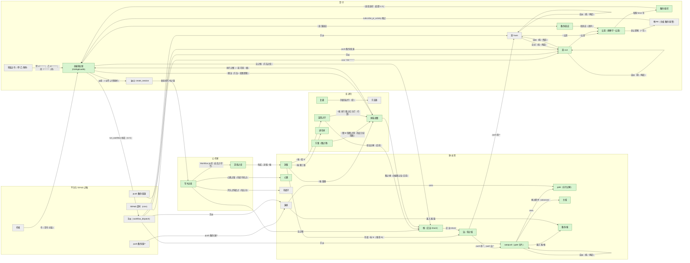

# 体系总图（心—脉—觉—长—学·一件一行·用之审入图）

> 本档由 `工具/体系总图.py` 生成（零 token·随 封版 --後 与总编辑之 --随治），⛔手改；改其表即改其器之码或其源档。判之义照 W908「用之审之果」（用／半用／未用／死）；名单外者机判：有跑且有读＝用、有一缺＝半用、俱无＝未用。每行带其源档。

## 一眼

- 截至第 487 章（正文之末章）；末真用之窗：第478—487章之 _器之迹.md。
- 件 337＝器 210、席 3、流 4、账 120｜用 293、半用 30、未用 12、死 2｜⛔ 0、⚠ 14
- 心 212（用 190·半 12·未 9·死 1）｜脉 23（用 19·半 4·未 0·死 0）｜觉 42（用 38·半 3·未 1·死 0）｜长 48（用 34·半 11·未 2·死 1）｜学 10（用 10·半 0·未 0·死 0）｜未归 2（用 2·半 0·未 0·死 0）
- ⛔ 即红 0：无
- ⚠ 随治、候审 14（W908 之治而未逾限 3、账之机判未用 11）——逐件见 ③
- 机制之流（⑥）：节 32、边 50（机取 19、表 31）；流之边俱有据——mermaid（GitHub 即绘）与文本之链见 ⑥
- 近之进化之末（⑦）：W921 取「执行清单（三等·书质为首·器生器守；甲之封证与空」（2026-11-24T19:30Z）——所废：执行之制 3.3 之手写落盘之表（无末跑、无灯）、W914 首察之空跑（六席 400 而四
- 灯（今算·--验 ⛔比·跑即亮）：件 🟢 159·🟡 1·🔴 0·⚪ 177；流之节 🟢 20·🟡 0·🔴 0·⚪ 12
- 读法·判：照 W908「用之审之果」；名单外者机判（有跑且有读＝用、有一缺＝半用、俱无＝未用）。「悖」＝判死／未用而仍有跑口；「今迹见……候复审」＝名单判半用而今迹已见。⛔＝器红级（全测之格「体系总图」报之、入器红账，⛔拦写书之封）；⚠＝只报。
- 读法·末真用：末十章 _器之迹.md 所见。其迹只录写书之坐「料成→器之迹之步」之跑（_账 记 __main__）——GitHub、他坐、封版闸後、被载者俱不入，故「无迹」必书其由：迹盲（其跑俱在盲处）／窗外末见第N章／全迹无。
- 读法·谁跑谁读：「（印令）」＝只印其令（自走、封毕之语）而主环照跑；「（载）」＝被 import；「（唯自测）」＝全测只跑其 --自测。载之者＝import 之者，引之者＝提其名之档。格中「等 N」者，`python3 工具/体系总图.py --件 名` 见其全。

## ⓪ 源之鲜

| 源 | 所至 | 不识／缺 |
|---|---|---|
| 器 `工具/*.py` | 210 件（常驻自驱 1：存底守） | 析崩 0；无 docstring 0 |
| 席 `工具/席/*.js` | 3 件 | — |
| 流 `.github/workflows/*.yml` | 4 件（触与调见 ① GitHub 之流） | — |
| 钩 `.claude/settings.json` | 事 3、钩 10 | — |
| git 钩 `工具/githooks/*` 与 merge 驱 | 1 件（pre-push）；merge 驱 10 | — |
| 账册 `设定/` | json 23、md 724、子目 9 → 行 120（单档 105、族 15 含档 2401） | 无首题／说明之键 11 |
| 封版 `工具/封版.py` | --前 调器 14；--後 调器 22（步 13、闸 12〔含左移之拦 4〕、存 3 去重）、载 5、印令 4——三者之名见 ① 封版之序 | — |
| 全测 `工具/全测.py` | 格 191、格所跑之器 192（唯取调；只印之示⛔算） | — |
| 入口 `工具/囤灰闸.py` | 真跑口 8；闭包可达 210／210 | — |
| 读者 | 222（器 209、席、流、钩、git 钩、总章、README、总圣经、canon；⛔本器） | — |
| 账之读 `囤灰闸.档之囤灰`（一义一判） | glob 之族而读 15 件；顶层 md 无引 9（日＝0 核之） | — |
| 器之迹 `版本/第N章/_器之迹.md` | 窗 第478—487章 10 档、器 82 名；全迹 99 档、器 310 名 | — |
| W908 用之审之名单 `设定/方案/W908.md`（该节之机读之块） | 件 51（块之行：器 31、账 23；判照之，与今机判之对照见 ③）；甲批 环1、环2、环3、环6、环8、乙批 环4、环5、环7、环9、环10、环11、环12 | 盘上无（已除）12：D1施.py、两册对限.py、书级基线.json、崩坏回修账.md、看官凭据.json、看官欠哨.py、节奏方差回补_优先序.json、行号随移.py、负测_D1施改单.py、负测_行号随移.py、负测_连读重出.py、进化链.py |
| 部之表（本器） | 已归 335 | 未归 2：_仓.py、_手排.py |
| 法用册 `设定/法用册.json` | 法 67、待 8、废 103；W908 治之限：废之条 0 档、待「用之审」限 无 | — |
| 机制之流 `本器之流节、流边之表`＋流之 on／if＋`接棒守` 之表 | 节 32、边 50（机取 19：流之 on／job 之 if／uses、兜底之令；表 31：逐边验其串在其档）；接棒守 之表 总编辑、主枝、巡警枝、巡印枝、巡印档、巡应枝、兜底之令 | — |
| 迹之源（活之色） `本器之迹表` | 源 17 类：巡印、巡应、心跳、存底、巡钟、主枝、报枝、报推、报在、报治、报闸、报演、卡、封、图档、迹、全测 | 灯以本地 origin/* 算（--摘、--件、--印、--随治 先取其旧者；写、--验 ⛔取；ZM_TU_NOFETCH=1 即⛔取）；取不得之件 ⚪「迹不可取」（⛔猜） |
| 工作流账 `设定/工作流账.json` | W9xx 之裁之末 8（⑦） | — |

## ① 五部之脊

| 部 | 其职 | 件 | 器／席／流／账 | 用 | 半用 | 未用 | 死 | ⛔ | ⚠ |
|---|---|---|---|---|---|---|---|---|---|
| 心 | 作家：造章诸席与其器——起草、记、审、守书之质、书之记忆与设定 | 212 | 139／3／0／70 | 190 | 12 | 9 | 1 | 0 | 10 |
| 脉 | 丝滑：推、闸、并、存底——章之封、推、GitHub 之闸与并、存底与锁（存底守名「守」而行存底，归此；验之者在觉） | 23 | 17／0／3／3 | 19 | 4 | 0 | 0 | 0 | 0 |
| 觉 | 守：巡、云巡、执行之守（诸钩）、诸哨（名以「哨」终者俱归此）——察停、察违、察费、察书之漂、守会话 | 42 | 34／0／1／7 | 38 | 3 | 1 | 0 | 0 | 1 |
| 长 | 进化：坑账、方法账、进化树、复盘、法用之守——方法之进与用之审 | 48 | 17／0／0／31 | 34 | 11 | 2 | 1 | 0 | 3 |
| 学 | 学：写书之道、大师进化账、拍库、起草令——写书之技之积 | 10 | 1／0／0／9 | 10 | 0 | 0 | 0 | 0 | 0 |
| 未归 | 部之表未归之件（⛔猜） | 2 | 2／0／0／0 | 2 | 0 | 0 | 0 | 0 | 0 |
| 合 | — | 337 | 210／3／4／120 | 293 | 30 | 12 | 2 | 0 | 14 |

### 封版之序（静析 `工具/封版.py`；⛔＝红即停、⚠＝只报不拦、〔若…〕＝其条件、并〔…〕＝并起）

- --前：跑轮→造式→坑账→大审→器物点名→囤灰闸→跑账→圣经随裁→质量三闸→席令之禁→法用之守→约到期（并起：小说检察官、开轮六检）
- --後·前置：记之缺 ⛔（载 记落）→阶段之数
- --後·步：净重对表 --补（净重对表）→同步全本阅读器→全书记忆随（全书记忆）→剧情链→剧情全图→人物链→进化树随（进化树）→器之迹（囤灰闸）→体系总图→回执对账 ⛔→开轮六检 ⛔→第零轮开镜庭 ⛔→造式之实（造式） ⛔
- --後·闸⛔：囤灰闸→法用之守〔若 N≥411〕→质量三闸→席令之禁→圣经随裁→全书记忆→器物点名〔若 有 _器物.md〕→第十一轮（小说检察官）→读者之快（全测；格：改单、圣经引号、坑账、暂停令、钩子挂载、约到期闸）→并〔读者之慢（全测）、医生（小说检察官）、末章硬闸（小说检察官）〕
- --後·其後：副本之免→席记「封版」段→活态之报 ⚠（全测；格：接力、跑账、负测·自进化环）→〔--演 至此止〕→章之件标成（载 工作流账）→提交
- --後·存⚠：存底 --存（存底）→存底 --标（存底）→撤锁（心跳）
- --後·收：泊章之语（载 推报）→封毕之语（印令 接棒守、推）
- --後 所载之库（import·随其函）：全测、对账预筛、工作流账、推报、记落；所印之令：接棒守、推、自进化环、记落

### GitHub 之流（静析 `.github/workflows/*.yml`：调＝非注、非 echo 之行中 python3 所调之器与 `uses:` 之流）

| 流 | 部 | 职 | 触 | 调 |
|---|---|---|---|---|
| autopush.yml | 脉 | 主枝之自推：沙盒只推暂存之枝——「章-N」、「治-<sha>」；GitHub 之机把它并进主枝：闸过即主枝进，红即主枝不… | push（章-*、治-*），手派 | gate.yml（账并、全测、推报）、全测、存底、推报、运营卡 |
| gate.yml | 脉 | 分片之闸——autopush 与 演练 同用：备候 → N 片各跑 全测 --片 | 他流所调 | 账并、全测、推报 |
| 巡.yml | 觉 | 云巡：停书之巡交 GitHub——章推之環每五分跑 `python3 工具/接棒守.py --云巡`：「止」即毕——零 … | cron */30 * * * *，手派，push（备份/巡演、章-*） | 接棒守 |
| 演练.yml | 脉 | 改流程之物，上线之前先於 GitHub 以真料演一回 | push（备份/演/*），手派 | gate.yml（账并、全测、推报）、全测、推报 |

## ② 一件一行

### 心（212）

| 件 | 部 | 何职 | 谁跑 | 何时跑 | 谁读其出 | 末真用 | 判 | 其源档 | 灯 |
|---|---|---|---|---|---|---|---|---|---|
| FS闸.py | 心 | FS 沉默闸：凡本章之回执全文不含某根逾期之 FS 编号者，判红 | 全测·FS沉默闸 | 每推（GitHub 全测） | 载之者：剧情全图、负测_FS裁过、负测_FS闸付语与期；引之者：canon、全测 | 第487章 | 用（机判：有跑有读） | 工具/FS闸.py | 🟢〔末 11-25 01:54（gate 之全测·报/推/治-7e56a3b4e0e1（成））·期 11.8 时（每推（≥ 每章））〕 |
| 书名不绑.py | 心 | ⛔不许以书名之字为尺去量正文，不许以「书名之许诺」立账挂限 | 全测·书名不绑 | 每推（GitHub 全测） | 引之者：全测 | 无迹（迹盲：GitHub·窗外末见第397章） | 用（机判：有跑有读） | 工具/书名不绑.py | 🟢〔末 11-25 01:54（gate 之全测·报/推/治-7e56a3b4e0e1（成））·期 11.8 时（每推（≥ 每章））〕 |
| 书级体检.py | 心 | 补十轮系统之唯一盲区 | 入口、全测·书级体检 | 主环手跑；每推（GitHub 全测） | 载之者：换型令、负测_书级体检、负测_在场之兑、负测_本章之失两式等 6；引之者：canon、全测、囤灰闸、尺之校等 7 | 第487章 | 用（机判：有跑有读） | 工具/书级体检.py | ⚪〔迹不可取·按需〕 |
| 亮点在.py | 心 | 骨记在不在 | 口·起草闸、全测·亮点在 | 每章起草；每推（GitHub 全测） | 引之者：全测、起草闸 | 第487章 | 用（机判：有跑有读） | 工具/亮点在.py | ⚪〔迹不可取·期 11.8 时（每章）〕 |
| 亮点对表.py | 心 | 2026-09-01 立病：亮点段与正文相犯，而全书无一道闸看得见——数闸只认「N个字」那一式，硬闸只认十八格，开轮十六… | 口·起草闸、口·起草闸（载） | 每章起草 | 载之者：亮点在、亮点界、净重对表、含拍等 15 | 第487章 | 用（机判：有跑有读） | 工具/亮点对表.py | ⚪〔迹不可取·期 11.8 时（每章）〕 |
| 亮点界.py | 心 | 拆出之章，其亮点段的界跟正文的界对不对得上 | 口·起草闸、全测·亮点界 | 每章起草；每推（GitHub 全测） | 载之者：息日链、负测_亮点界；引之者：全测、起草闸 | 第487章 | 用（机判：有跑有读） | 工具/亮点界.py | ⚪〔迹不可取·期 11.8 时（每章）〕 |
| 人物链.py | 心 | 把诸段之记零 token 并成每人从第 1 章到末章之一条链 | 封版·後、全测·章料（唯自测） | 每章封时（封版 --後）；每推（GitHub 全测） | 载之者：封版；引之者：全测 | 第487章 | 用（机判：有跑有读） | 工具/人物链.py | 🟢〔末 11-25 01:32（第486章之封）·期 11.8 时（每章）〕 |
| 人账.py | 心 | 其红已上磁盘核 | 全测·人账闸、全测·负测·人账闸（唯自测） | 每推（GitHub 全测） | 载之者：负测_人账之还；引之者：全测 | 无迹（迹盲：GitHub·窗外末见第397章） | 用（机判：有跑有读） | 工具/人账.py | 🟢〔末 11-25 01:54（gate 之全测·报/推/治-7e56a3b4e0e1（成））·期 11.8 时（每推（≥ 每章））〕 |
| 全书记忆.py | 心 | 全书记忆之闸：自 设定/全书记忆/总览.md 立起之後启用：每一正文章须有 设定/全书记忆/第N章.md，且其所记 sh… | 封版·後、全测·全书记忆 | 每章封时（封版 --後）；每推（GitHub 全测） | 载之者：记落、还账；引之者：全测、封版 | 第487章 | 用（机判：有跑有读） | 工具/全书记忆.py | 🟢〔末 11-25 01:32（第486章之封）·期 11.8 时（每章）〕 |
| 净重对表.py | 心 | 施工表锁定行自书之「净重N」，拿尺回去量一遍 | 封版·前（载）、封版·後、席·造章、全测·净重对表 | 每章封前（封版 --前）；每章封时（封版 --後）；每章（造章之席）；每推（GitHub 全测） | 载之者：净重趋、封版、承、段案验等 8；引之者：canon、全测、席·造章、总圣经等 8 | 第487章 | 用（机判：有跑有读） | 工具/净重对表.py | 🟢〔末 11-25 01:32（第486章之封）·期 11.8 时（每章）〕 |
| 净重趋.py | 心 | 净重之趋——一章一章看不出来的那一样 | 全测·净重之趋 | 每推（GitHub 全测） | 引之者：全测 | 无迹（迹盲：GitHub·窗外末见第397章） | 用（机判：有跑有读） | 工具/净重趋.py | 🟢〔末 11-25 01:54（gate 之全测·报/推/治-7e56a3b4e0e1（成））·期 11.8 时（每推（≥ 每章））〕 |
| 分量闸.py | 心 | 作者立过一条硬线，而盘上没有一样东西在量它 | 全测·分量闸 | 每推（GitHub 全测） | 载之者：段案验、第零轮开镜庭、负测_分量闸之读、负测_分量闸取正文等 6；引之者：canon、全测、尺之校、裁之生效 | 第487章 | 用（机判：有跑有读） | 工具/分量闸.py | 🟢〔末 11-25 01:54（gate 之全测·报/推/治-7e56a3b4e0e1（成））·期 11.8 时（每推（≥ 每章））〕 |
| 刻意之疲.py | 心 | 只照镜、不拦：把末 12 章之章尾之形摆出来，给大审之通读者看；判由人眼 | 口·大审、全测·刻意之疲 | 每十章（大审之包）；每推（GitHub 全测） | 引之者：全测、大审 | 无迹（窗外末见第398章） | 用（机判：有跑有读） | 工具/刻意之疲.py | ⚪〔迹不可取·期 117.6 时（每十章）〕 |
| 剧情全图.py | 心 | 零 token | 口·大审、封版·後、全测·剧情全图 | 每章封时（封版 --後）；每十章（大审之包）；每推（GitHub 全测） | 引之者：全测、大审、封版 | 第487章 | 用（机判：有跑有读） | 工具/剧情全图.py | 🟢〔末 11-25 01:32（第486章之封）·期 11.8 时（每章）〕 |
| 剧情庭之关.py | 心 | 自第 381 章起，每十章一段；段内已有章封版者，须有 设定/剧情庭_势_第<段首>段.md，且其内含「裁」字样；缺即红 | 全测·剧情庭之关 | 每推（GitHub 全测） | 载之者：造式验；引之者：全测、推 | 无迹（迹盲：GitHub·窗外末见第421章） | 用（机判：有跑有读） | 工具/剧情庭之关.py | 🟢〔末 11-25 01:54（gate 之全测·报/推/治-7e56a3b4e0e1（成））·期 11.8 时（每推（≥ 每章））〕 |
| 剧情链.py | 心 | 零 token：每章写完就精读、详记，整合成一条从头到尾的链，日後大改不必再从头读 | 封版·後、全测·章料 | 每章封时（封版 --後）；每推（GitHub 全测） | 载之者：剧情全图；引之者：全测、封版、还账 | 第487章 | 半用（W908：只验其新）｜今迹见第487章（机判：用）——候复审 | 工具/剧情链.py | 🟢〔末 11-25 01:32（第486章之封）·期 11.8 时（每章）〕 |
| 合玉闸.py | 心 | `F026_合玉后完整态` 那一张卡之验码，今日方才有 | 全测·合玉闸 | 每推（GitHub 全测） | 引之者：全测 | 无迹（迹盲：GitHub·窗外末见第397章） | 用（机判：有跑有读） | 工具/合玉闸.py | 🟢〔末 11-25 01:54（gate 之全测·报/推/治-7e56a3b4e0e1（成））·期 11.8 时（每推（≥ 每章））〕 |
| 同步全本阅读器.py | 心 | 把正文 Markdown 同步进全本 HTML 阅读器 | 口·跑轮、封版·後 | 每章封时（封版 --後）；存版（跑轮） | 引之者：封版、小说检察官、改单、负测_段间空行闸等 6 | 第487章 | 用（机判：有跑有读） | 工具/同步全本阅读器.py | 🟢〔末 11-25 01:32（第486章之封）·期 11.8 时（每章）〕 |
| 含拍.py | 心 | 一拍整段被紧挨着的另一拍逐字含住：并段之後旧拍没删 | 口·起草闸、全测·含拍 | 每章起草；每推（GitHub 全测） | 载之者：负测_含拍；引之者：全测、起草闸 | 第487章 | 用（机判：有跑有读） | 工具/含拍.py | ⚪〔迹不可取·期 11.8 时（每章）〕 |
| 器物点名.py | 心 | 295第6轮记欠、295第7轮之坐立 | 封版·前、封版·後、全测·器物册·逐章回灌 | 每章封前（封版 --前）；每章封时（封版 --後）；每推（GitHub 全测） | 载之者：负测_器物点名、负测_薄章之禁；引之者：canon、全测、封版、总圣经 | 第487章 | 用（机判：有跑有读） | 工具/器物点名.py | 🟢〔末 11-25 01:32（第486章之封）·期 11.8 时（每章）〕 |
| 回执对账.py | 心 | 回执对账闸 | 封版·後 | 每章封时（封版 --後） | 引之者：封版、负测_封版之凭 | 第487章 | 用（机判：有跑有读） | 工具/回执对账.py | 🟢〔末 11-25 01:32（第486章之封）·期 11.8 时（每章）〕 |
| 圣经引号.py | 心 | 逐条印出在役诸档里 `圣经:NNNN` 之引今天指着哪一行 | 全测·圣经引号 | 每章封时（封版 --後 之全测 --只）；每推（GitHub 全测） | 引之者：全测、总圣经 | 第487章 | 用（机判：有跑有读） | 工具/圣经引号.py | 🟢〔末 11-25 01:54（gate 之全测·报/推/治-7e56a3b4e0e1（成））·期 11.8 时（每推（≥ 每章））〕 |
| 圣经随裁.py | 心 | 凡 0927 以後之裁与剧情庭之裁，须已落进圣经——圣经里须有该档之名，或该档自书「圣经无改」并写其由 | 封版·前、封版·後、全测·圣经随裁 | 每章封前（封版 --前）；每章封时（封版 --後）；每推（GitHub 全测） | 引之者：全测、封版 | 第487章 | 用（机判：有跑有读） | 工具/圣经随裁.py | 🟢〔末 11-25 01:32（第486章之封）·期 11.8 时（每章）〕 |
| 外事尺.py | 心 | 为「一章比一章好看」之案 #14 | 口·起草闸 | 每章起草 | 引之者：canon、总圣经、起草闸 | 第487章 | 用（机判：有跑有读） | 工具/外事尺.py | ⚪〔迹不可取·期 11.8 时（每章）〕 |
| 外声闸.py | 心 | 全书审计第一层第二条／制度补法 M3 | 口·大审、全测·外声闸 | 每十章（大审之包）；每推（GitHub 全测） | 载之者：负测_外声三式；引之者：全测、大审 | 无迹（窗外末见第397章） | 半用（W908：恒 True（全测.py:888-910））→W908 环8 而无其限 | 工具/外声闸.py | ⚪〔迹不可取·期 117.6 时（每十章）〕 |
| 大审.py | 心 | 作者令：「这个小说应该平均10章就应该从头到尾我们来进行一个剧情和质量等等各个方面严格把控，看看有没有达到一个最高等级…… | 入口、口·接棒守（载）、口·自走（印令）、口·自走（载）等 8 | 每章封前（封版 --前）；每章（造章之席）；自走每跑（主环）；巡、候主（接棒守）等 7 | 载之者：剧情全图、接棒守、暂停令、段序之守等 10；引之者：canon、全测、刻意之疲、囤灰闸等 7 | 第487章 | 用（W908：有疵：:343 以头注之⛔计红）→W908 环8 而无其限 | 工具/大审.py | 🟢〔末 11-25 04:28（随载者 接棒守：备份/巡应·本地未取）·期 11.8 时（每章）〕 |
| 大问表.py | 心 | 全书审计第一层第三条／制度补法 M4 | 全测·大问表 | 每推（GitHub 全测） | 载之者：剧情全图、第零轮开镜庭；引之者：全测、负测_全测崩绿、负测_大问挂账 | 无迹（迹盲：GitHub·窗外末见第473章） | 用（机判：有跑有读） | 工具/大问表.py | 🟢〔末 11-25 01:54（gate 之全测·报/推/治-7e56a3b4e0e1（成））·期 11.8 时（每推（≥ 每章））〕 |
| 字数闸.py | 心 | 「他说了『……』，N个字」里那个 N 数得对不对 | 口·起草闸、全测·字数闸 | 每章起草；每推（GitHub 全测） | 载之者：负测_字数闸；引之者：全测、囤灰闸、起草闸 | 第487章 | 用（机判：有跑有读） | 工具/字数闸.py | ⚪〔迹不可取·期 11.8 时（每章）〕 |
| 对账预筛.py | 心 | 零 token 之全书对账前置 | 封版·前（载）、封版·後（载）、全测·对账预筛（唯自测） | 每章封前（封版 --前）；每章封时（封版 --後）；每推（GitHub 全测） | 载之者：封版、总编辑复核、改记、段序之守等 6；引之者：全测 | 无迹（迹盲：GitHub、被载·窗外末见第408章） | 半用（W908：预筛之职无入口；章号／汉章行为库） | 工具/对账预筛.py | 🟢〔末 11-25 01:32（第486章之封）·期 11.8 时（每章）〕 |
| 小说检察官.py | 心 | 《镇冢秘术》机械初检 + AI 人工复核双闸 | 口·自走（印令）、封版·前、封版·前（载）、封版·後等 9 | 每章封前（封版 --前）；每章封时（封版 --後）；自走每跑（主环）；每推（GitHub 全测） | 载之者：全测、净重对表、剧情全图、封版等 7；引之者：十一轮哨、总圣经、自走、记料等 11 | 第487章 | 用（机判：有跑有读） | 工具/小说检察官.py | 🟢〔末 11-25 01:32（第486章之封）·期 11.8 时（每章）〕 |
| 尺之校.py | 心 | 一条红连着几章清不掉时，先问这把尺 | 口·自走、口·自走（载） | 自走每跑（主环） | 载之者：自走 | 无迹（全迹无） | 用（机判：有跑有读） | 工具/尺之校.py | ⚪〔迹不可取·期 11.8 时（每章）〕 |
| 崩坏闸.py | 心 | 剧情前後不许崩：死了的人不许活过来，没立过的能不许凭空出现 | 口·起草闸、席·造章 | 每章起草；每章（造章之席） | 引之者：席·造章、负测_造章令、起草闸 | 第487章 | 用（机判：有跑有读） | 工具/崩坏闸.py | ⚪〔迹不可取·期 11.8 时（每章）〕 |
| 席令之禁.py | 心 | 每一份席令里，有没有写着「席在跑时不许动整个工作区」 | 封版·前、封版·後、全测·席令之禁（唯自测） | 每章封前（封版 --前）；每章封时（封版 --後）；每推（GitHub 全测） | 引之者：全测、封版 | 第487章 | 用（机判：有跑有读） | 工具/席令之禁.py | 🟢〔末 11-25 01:32（第486章之封）·期 11.8 时（每章）〕 |
| 席法.py | 心 | 诸席之 .js 写法闸：专防本坐在写席时反复踩的那几样 | 口·自走（印令）、全测·席法、全测·负测·席法（唯自测） | 自走每跑（主环）；每推（GitHub 全测） | 载之者：续跑之守；引之者：README、全测、接力、自走 | 第487章 | 用（机判：有跑有读） | 工具/席法.py | ⚪〔迹不可取·期 11.8 时（每章）〕 |
| 开轮六检.py | 心 | 开轮七检：诸检：人名计数之误、撞号与merged、锚之长、招五之第二形、生死线之期、骨之方向、未答之问、承前之判、悬账之… | 封版·前、封版·後、全测·开轮十六检 | 每章封前（封版 --前）；每章封时（封版 --後）；每推（GitHub 全测） | 载之者：比带、负测_向之口、负测_承前闸、负测_摆问之嵌等 6；引之者：canon、全测、封版、总圣经等 8 | 第487章 | 用（机判：有跑有读） | 工具/开轮六检.py | 🟢〔末 11-25 01:32（第486章之封）·期 11.8 时（每章）〕 |
| 息日链.py | 心 | 陈砚那本息账的日子，跨章接不接得上 | 口·起草闸、全测·息日链 | 每章起草；每推（GitHub 全测） | 载之者：负测_息日链；引之者：全测、负测_窗界哨、起草闸 | 第487章 | 用（机判：有跑有读） | 工具/息日链.py | ⚪〔迹不可取·期 11.8 时（每章）〕 |
| 感官趋.py | 心 | 一章之感官由 `比带` 量，而一段之感官没有人数 | 全测·感官之趋 | 每推（GitHub 全测） | 引之者：全测 | 无迹（迹盲：GitHub·窗外末见第397章） | 用（机判：有跑有读） | 工具/感官趋.py | 🟢〔末 11-25 01:54（gate 之全测·报/推/治-7e56a3b4e0e1（成））·期 11.8 时（每推（≥ 每章））〕 |
| 承.py | 心 | 容器重启後，从诸 workflow 之 journal 收第 N 章已成之段，造 造章.js 之 args.承与包裹 | 口·自走、口·自走（载）、席·造章、全测·负测·承（唯自测） | 每章（造章之席）；自走每跑（主环）；每推（GitHub 全测） | 载之者：复盘、大师之关、续跑之守、自走等 6；引之者：全测、囤灰闸、工作流账、席·造章等 5 | 第486章 | 用（机判：有跑有读） | 工具/承.py | 🟢〔末 11-25 01:32（迹·第486章）·期 11.8 时（每章）〕 |
| 抄袭闸.py | 心 | 新写的一章，不许拿前面章节的句子凑成 | 口·大审、口·起草闸、席·造章、全测·抄袭闸 | 每章起草；每章（造章之席）；每十章（大审之包）；每推（GitHub 全测） | 载之者：全测；引之者：大审、席·造章、起草闸 | 第487章 | 用（机判：有跑有读） | 工具/抄袭闸.py | ⚪〔迹不可取·期 11.8 时（每章）〕 |
| 换型令.py | 心 | 连锁一旦逾限，下一章就不许再是同一型 | 全测·换型令 | 每推（GitHub 全测） | 载之者：第零轮开镜庭；引之者：全测、尺之校、自省哨、负测_换型令之尺 | 无迹（迹盲：GitHub·窗外末见第398章） | 用（机判：有跑有读） | 工具/换型令.py | 🟢〔末 11-25 01:54（gate 之全测·报/推/治-7e56a3b4e0e1（成））·期 11.8 时（每推（≥ 每章））〕 |
| 接口验.py | 心 | 圣经之锚所录「N-1之末句逐字」与 N-1 正文之真末句对不对 | 全测·接口验、全测·负测·接口验（唯自测） | 每推（GitHub 全测） | 引之者：全测、总圣经 | 无迹（迹盲：GitHub·窗外末见第397章） | 用（机判：有跑有读） | 工具/接口验.py | 🟢〔末 11-25 01:54（gate 之全测·报/推/治-7e56a3b4e0e1（成））·期 11.8 时（每推（≥ 每章））〕 |
| 改单.py | 心 | 一切皆可改；改的前提只一条：让这本书更好 | 口·自走（印令）、席·剧情庭、全测·改单、全测·负测·改单（唯自测） | 每章封时（封版 --後 之全测 --只）；自走每跑（主环）；每推（GitHub 全测）；每段、改剧情前（剧情庭之席） | 引之者：全测、席·剧情庭、总圣经、总章等 8 | 第487章 | 用（机判：有跑有读） | 工具/改单.py | ⚪〔迹不可取·期 11.8 时（每章）〕 |
| 改记.py | 心 | 零 token 读出改动之详录 | 口·大审、全测·改记（唯自测） | 每十章（大审之包）；每推（GitHub 全测） | 引之者：全测、大审 | 无迹（窗外末见第408章） | ⚠ 未用（W908：迹窗无真跑；常令:43 所点之读路）→W908 环8 而无其限｜治已行（W908 环8 接入·今机判：用；口·大审）——候复审 | 工具/改记.py | ⚪〔迹不可取·期 117.6 时（每十章）〕 |
| 数闸.py | 心 | 全书审计第一层第一条 | 全测·数闸 | 每推（GitHub 全测） | 载之者：负测_数闸；引之者：全测 | 第487章 | 用（机判：有跑有读） | 工具/数闸.py | 🟢〔末 11-25 01:54（gate 之全测·报/推/治-7e56a3b4e0e1（成））·期 11.8 时（每推（≥ 每章））〕 |
| 无闸之卡.py | 心 | ERROR 之卡，须有一样东西在看着它 | 全测·无闸之卡 | 每推（GitHub 全测） | 引之者：全测 | 无迹（迹盲：GitHub·窗外末见第397章） | 用（机判：有跑有读） | 工具/无闸之卡.py | 🟢〔末 11-25 01:54（gate 之全测·报/推/治-7e56a3b4e0e1（成））·期 11.8 时（每推（≥ 每章））〕 |
| 棘轮预检.py | 心 | 2026-09-01 立病：改文之後直接 --存版，棘轮闸事後才报回退，遂须 --补存 补一版 | 口·起草闸、全测·负测·棘轮预检（唯自测） | 每章起草；每推（GitHub 全测） | 载之者：负测_棘轮v01、负测_棘轮预检；引之者：canon、全测、总圣经、起草闸 | 第487章 | 用（机判：有跑有读） | 工具/棘轮预检.py | ⚪〔迹不可取·期 11.8 时（每章）〕 |
| 欠账闸.py | 心 | 零 token：主案之 G 号执行了没有 | 全测·章料（唯自测） | 每推（GitHub 全测） | 载之者：还账；引之者：全测 | 无迹（迹盲：GitHub·窗外末见第458章） | 半用（W908：职空；还账.py:930 载之） | 工具/欠账闸.py | ⚪〔按需·末 11-17 11:15（迹·第458章）〕 |
| 段料.py | 心 | 每十章一份段案之前，机器先把料汇齐，设计席只读此档 | 口·自走（印令）、席·剧情庭、全测·二代诸器 | 自走每跑（主环）；每推（GitHub 全测）；每段、改剧情前（剧情庭之席） | 载之者：剧情全图、段案验；引之者：全测、席·剧情庭、总章、改单等 6 | 无迹（窗外末见第408章） | 用（机判：有跑有读） | 工具/段料.py | ⚪〔迹不可取·期 11.8 时（每章）〕 |
| 段案验.py | 心 | 段案取骨之後、交各章执笔之前跑；红即回取骨席只治红处 | 口·自走、席·剧情庭、全测·二代诸器 | 自走每跑（主环）；每推（GitHub 全测）；每段、改剧情前（剧情庭之席） | 载之者：剧情全图、暂停令、段料、造式验；引之者：全测、席·剧情庭、总章、自走 | 无迹（窗外末见第472章） | 用（机判：有跑有读） | 工具/段案验.py | 🟡〔末 11-19 15:02（迹·第472章）·期 11.8 时（每章）·自解停 11-24 07:37 起算·迟〕 |
| 比带.py | 心 | 比带所治之伤：一把带，取错了比的人，就把三处好文判成了伤 | 随其载者（看官、约到期、负测_比带） | 随其载者 | 载之者：看官、约到期、负测_比带；引之者：总圣经、感官趋 | 第487章 | 用（机判：有跑有读） | 工具/比带.py | ⚪〔迹不可取·按需〕 |
| 法典闸.py | 心 | 闸十·法典闸 | 口·跑轮、口·跑轮（载） | 存版（跑轮） | 载之者：跑轮 | 无迹（全迹无） | 半用（W908：279A 支恒不触（:47-51））→随 W908 环7（乙批·无专限：只 ⚠） | 工具/法典闸.py | ⚪〔按需·末 11-25 01:32（随载者 跑轮：第486章之封）〕 |
| 漂移全书.py | 心 | 漂移·全书——漂移哨看得见，而从来没有人拿它去看别的章 | 全测·漂移全书 | 每推（GitHub 全测） | 引之者：全测 | 无迹（迹盲：GitHub·窗外末见第397章） | 用（机判：有跑有读） | 工具/漂移全书.py | 🟢〔末 11-25 01:54（gate 之全测·报/推/治-7e56a3b4e0e1（成））·期 11.8 时（每推（≥ 每章））〕 |
| 爆窗.py | 心 | 久旱报：连着多少章没有一次爆章／转章了，本代之最大干旱是多少 | 全测·爆窗、全测·负测·爆窗（唯自测） | 每推（GitHub 全测） | 引之者：全测 | 无迹（迹盲：GitHub·窗外末见第397章） | 用（机判：有跑有读） | 工具/爆窗.py | 🟢〔末 11-25 01:54（gate 之全测·报/推/治-7e56a3b4e0e1（成））·期 11.8 时（每推（≥ 每章））〕 |
| 版档指纹.py | 心 | 拿尺回去量每一个版档，看它与台账自书之「净重」对不对得上 | 口·跑轮（印令）、全测·版档指纹 | 存版（跑轮）；每推（GitHub 全测） | 引之者：全测、跑轮 | 无迹（窗外末见第397章） | 用（机判：有跑有读） | 工具/版档指纹.py | ⚪〔迹不可取·按需〕 |
| 看官.py | 心 | 本书之第一只外眼 | 随其载者（第零轮开镜庭） | 随其载者 | 载之者：第零轮开镜庭；引之者：canon、总圣经、重出趋 | 无迹（迹盲：被载·窗外末见第410章） | 半用（W908：--连读 死；白文／拍／_重出率 为库）→随 W908 环7（乙批·无专限：只 ⚠） | 工具/看官.py | ⚪〔迹不可取·按需〕 |
| 硬闸.py | 心 | 单一真源：硬项之集先前散在四处，各记各的，遂成两本账 | 口·起草闸、口·起草闸（载）、口·跑轮（载） | 每章起草；存版（跑轮） | 载之者：净重对表、负测_硬闸、起草闸、跑轮等 5 | 第487章 | 用（机判：有跑有读） | 工具/硬闸.py | 🟢〔末 11-25 01:32（随载者 跑轮：第486章之封）·期 11.8 时（每章）〕 |
| 稿差.py | 心 | 回写之後逻辑审·2 之窄审之门 | 席·造章、全测·负测·稿差（唯自测） | 每章（造章之席）；每推（GitHub 全测） | 引之者：全测、席·造章、总章、法用之守等 5 | 第487章 | 用（机判：有跑有读） | 工具/稿差.py | ⚪〔迹不可取·期 11.8 时（每章）〕 |
| 章料.py | 心 | 零 token 汇一章之料，席只读此一档 | 口·自走、口·自走（载）、口·跑轮（载）、封版·前（载）等 6 | 每章封前（封版 --前）；每章（造章之席）；自走每跑（主环）；存版（跑轮）等 5 | 载之者：人物链、复盘、封版、总编辑复核等 16；引之者：全测、席·造章、总章、方案等 6 | 第487章 | 用（机判：有跑有读） | 工具/章料.py | 🟢〔末 11-25 01:32（第486章之封）·期 11.8 时（每章）〕 |
| 第零轮开镜庭.py | 心 | 第零轮 · 开镜庭 | 口·自走（印令）、封版·後、席·造章、全测·第零轮 | 每章封时（封版 --後）；每章（造章之席）；自走每跑（主环）；每推（GitHub 全测） | 载之者：记料、负测_上瘾四问、负测_公开量表格；引之者：全测、封版、席·造章、总圣经等 10 | 第487章 | 用（W908：有疵：问七索死账）→随 W908 环7（乙批·无专限：只 ⚠） | 工具/第零轮开镜庭.py | 🟢〔末 11-25 01:32（第486章之封）·期 11.8 时（每章）〕 |
| 约到期.py | 心 | 约到期闸 | 封版·前、全测·约到期闸 | 每章封前（封版 --前）；每章封时（封版 --後 之全测 --只）；每推（GitHub 全测） | 载之者：剧情全图、负测_约到期；引之者：全测、封版、总圣经 | 第487章 | 用（机判：有跑有读） | 工具/约到期.py | 🟢〔末 11-25 01:32（第486章之封）·期 11.8 时（每章）〕 |
| 自走.py | 心 | 「设置个机制，跑起来就必须得跑起来，不能再停下了」 | 入口、口·接棒守（印令）、口·接棒守（载）、全测·负测·自走（唯自测） | 巡、候主（接棒守）；主环手跑；每推（GitHub 全测） | 载之者：会话之守、接棒守、方法坑账、暂停令等 6；引之者：README、全测、刻意之疲、囤灰闸等 16 | 无迹（窗外末见第400章） | 用（机判：有跑有读） | 工具/自走.py | ⚪〔按需·末 11-25 04:28（随载者 接棒守：备份/巡应·本地未取）〕 |
| 记料.py | 心 | 零 token：把记席九件事要翻的诸账之相关段一次汇成一档，记席一回读毕、⛔逐档翻找 | 席·造章、全测·章料（唯自测） | 每章（造章之席）；每推（GitHub 全测） | 引之者：全测、席·造章 | 第487章 | 用（机判：有跑有读） | 工具/记料.py | ⚪〔迹不可取·期 11.8 时（每章）〕 |
| 记落.py | 心 | 零 token：记席所留之纯机械之格，器代填、器代核 | 口·大审、口·自走（印令）、封版·後（印令）、封版·後（载）等 6 | 每章封时（封版 --後）；每章（造章之席）；自走每跑（主环）；每十章（大审之包）等 5 | 载之者：封版、记料；引之者：全测、大审、席·造章、总章等 6 | 第487章 | 用（机判：有跑有读） | 工具/记落.py | 🟢〔末 11-25 01:32（第486章之封）·期 11.8 时（每章）〕 |
| 负测_FS裁过.py | 心 | 负测 · FS闸之「裁过的不许再催」 | 全测·负测·FS裁过 | 每推（GitHub 全测） | 引之者：全测 | 无迹（迹盲：GitHub·窗外末见第397章） | 用（机判：有跑有读） | 工具/负测_FS裁过.py | 🟢〔末 11-25 01:54（gate 之全测·报/推/治-7e56a3b4e0e1（成））·期 11.8 时（每推（≥ 每章））〕 |
| 负测_FS闸付语与期.py | 心 | 负测 · FS闸之付语与「期对线」 | 全测·负测·FS闸付语与期 | 每推（GitHub 全测） | 引之者：全测 | 无迹（迹盲：GitHub·窗外末见第397章） | 用（机判：有跑有读） | 工具/负测_FS闸付语与期.py | 🟢〔末 11-25 01:54（gate 之全测·报/推/治-7e56a3b4e0e1（成））·期 11.8 时（每推（≥ 每章））〕 |
| 负测_canon禁式之界.py | 心 | 负测 · canon forbid 之量界 | 全测·负测·canon禁式之界 | 每推（GitHub 全测） | 引之者：全测 | 无迹（迹盲：GitHub·窗外末见第397章） | 用（机判：有跑有读） | 工具/负测_canon禁式之界.py | 🟢〔末 11-25 01:54（gate 之全测·报/推/治-7e56a3b4e0e1（成））·期 11.8 时（每推（≥ 每章））〕 |
| 负测_三尺同量.py | 心 | 负测 · 三尺同量 | 全测·负测·三尺同量 | 每推（GitHub 全测） | 引之者：全测 | 无迹（迹盲：GitHub·窗外末见第397章） | 用（机判：有跑有读） | 工具/负测_三尺同量.py | 🟢〔末 11-25 01:54（gate 之全测·报/推/治-7e56a3b4e0e1（成））·期 11.8 时（每推（≥ 每章））〕 |
| 负测_上瘾四问.py | 心 | 负测 · 开镜庭十二「上瘾四问」 | 全测·负测·上瘾四问 | 每推（GitHub 全测） | 引之者：全测 | 无迹（迹盲：GitHub·窗外末见第400章） | 用（机判：有跑有读） | 工具/负测_上瘾四问.py | 🟢〔末 11-25 01:54（gate 之全测·报/推/治-7e56a3b4e0e1（成））·期 11.8 时（每推（≥ 每章））〕 |
| 负测_书级体检.py | 心 | 负测 · 书级体检 | 全测·负测·书级体检 | 每推（GitHub 全测） | 引之者：全测 | 无迹（迹盲：GitHub·窗外末见第397章） | 用（机判：有跑有读） | 工具/负测_书级体检.py | 🟢〔末 11-25 01:54（gate 之全测·报/推/治-7e56a3b4e0e1（成））·期 11.8 时（每推（≥ 每章））〕 |
| 负测_亮点对表.py | 心 | 负测·亮点对表 · 2026-09-01 立要害不在「会不会报红」，在三样：①以旧式回灌：拿 289 v20灌回去，须逮… | 全测·负测·亮点对表 | 每推（GitHub 全测） | 引之者：全测 | 无迹（迹盲：GitHub·窗外末见第397章） | 用（机判：有跑有读） | 工具/负测_亮点对表.py | 🟢〔末 11-25 01:54（gate 之全测·报/推/治-7e56a3b4e0e1（成））·期 11.8 时（每推（≥ 每章））〕 |
| 负测_亮点残引.py | 心 | 负测·亮点残引 | 全测·负测·亮点残引 | 每推（GitHub 全测） | 引之者：全测 | 无迹（迹盲：GitHub·窗外末见第397章） | 用（机判：有跑有读） | 工具/负测_亮点残引.py | 🟢〔末 11-25 01:54（gate 之全测·报/推/治-7e56a3b4e0e1（成））·期 11.8 时（每推（≥ 每章））〕 |
| 负测_亮点界.py | 心 | 负测·亮点界 · 2026-09-05 立要害不在「会不会报红」，在四样：①以旧式回灌：拿 fe37e08f 之前的 1… | 全测·亮点界 | 每推（GitHub 全测） | 引之者：全测 | 第487章 | 用（机判：有跑有读） | 工具/负测_亮点界.py | 🟢〔末 11-25 01:54（gate 之全测·报/推/治-7e56a3b4e0e1（成））·期 11.8 时（每推（≥ 每章））〕 |
| 负测_人账之还.py | 心 | 负测·人账之还 | 全测·负测·人账之还 | 每推（GitHub 全测） | 引之者：全测 | 无迹（迹盲：GitHub·窗外末见第397章） | 用（机判：有跑有读） | 工具/负测_人账之还.py | 🟢〔末 11-25 01:54（gate 之全测·报/推/治-7e56a3b4e0e1（成））·期 11.8 时（每推（≥ 每章））〕 |
| 负测_入出同拍之镜.py | 心 | 负测 · 「入出同拍」之镜 | 全测·负测·入出同拍之镜 | 每推（GitHub 全测） | 引之者：全测 | 无迹（迹盲：GitHub·窗外末见第397章） | 用（机判：有跑有读） | 工具/负测_入出同拍之镜.py | 🟢〔末 11-25 01:54（gate 之全测·报/推/治-7e56a3b4e0e1（成））·期 11.8 时（每推（≥ 每章））〕 |
| 负测_公开量表格.py | 心 | 负测 · 开镜庭十一「公开量表动了几格」 | 全测·负测·公开量表格 | 每推（GitHub 全测） | 引之者：全测 | 无迹（迹盲：GitHub·窗外末见第400章） | 用（机判：有跑有读） | 工具/负测_公开量表格.py | 🟢〔末 11-25 01:54（gate 之全测·报/推/治-7e56a3b4e0e1（成））·期 11.8 时（每推（≥ 每章））〕 |
| 负测_净重一处.py | 心 | 负测·净重一处 | 全测·负测·净重一处 | 每推（GitHub 全测） | 引之者：全测 | 无迹（迹盲：GitHub·窗外末见第397章） | 用（机判：有跑有读） | 工具/负测_净重一处.py | 🟢〔末 11-25 01:54（gate 之全测·报/推/治-7e56a3b4e0e1（成））·期 11.8 时（每推（≥ 每章））〕 |
| 负测_净重取形.py | 心 | 负测·净重取形 | 全测·负测·净重取形 | 每推（GitHub 全测） | 引之者：全测 | 无迹（迹盲：GitHub·窗外末见第397章） | 用（机判：有跑有读） | 工具/负测_净重取形.py | 🟢〔末 11-25 01:54（gate 之全测·报/推/治-7e56a3b4e0e1（成））·期 11.8 时（每推（≥ 每章））〕 |
| 负测_分量闸之读.py | 心 | 负测·分量闸之读 | 全测·负测·分量闸之读 | 每推（GitHub 全测） | 引之者：全测 | 无迹（迹盲：GitHub·窗外末见第397章） | 用（机判：有跑有读） | 工具/负测_分量闸之读.py | 🟢〔末 11-25 01:54（gate 之全测·报/推/治-7e56a3b4e0e1（成））·期 11.8 时（每推（≥ 每章））〕 |
| 负测_分量闸取正文.py | 心 | 负测 · 分量闸取数之口径 | 全测·负测·分量闸取正文 | 每推（GitHub 全测） | 引之者：全测 | 无迹（迹盲：GitHub·窗外末见第397章） | 用（机判：有跑有读） | 工具/负测_分量闸取正文.py | 🟢〔末 11-25 01:54（gate 之全测·报/推/治-7e56a3b4e0e1（成））·期 11.8 时（每推（≥ 每章））〕 |
| 负测_到期账词表.py | 心 | 负测·到期账之「已清」词表 | 全测·负测·到期账词表 | 每推（GitHub 全测） | 引之者：全测 | 无迹（迹盲：GitHub·窗外末见第397章） | 用（机判：有跑有读） | 工具/负测_到期账词表.py | 🟢〔末 11-25 01:54（gate 之全测·报/推/治-7e56a3b4e0e1（成））·期 11.8 时（每推（≥ 每章））〕 |
| 负测_叠词闸.py | 心 | 负测·叠词粘连闸 | 全测·负测·叠词闸 | 每推（GitHub 全测） | 引之者：全测 | 无迹（迹盲：GitHub·窗外末见第397章） | 用（机判：有跑有读） | 工具/负测_叠词闸.py | 🟢〔末 11-25 01:54（gate 之全测·报/推/治-7e56a3b4e0e1（成））·期 11.8 时（每推（≥ 每章））〕 |
| 负测_向之口.py | 心 | 负测 · `开轮六检::⑲` 之卡口 | 全测·负测·⑲卡口 | 每推（GitHub 全测） | 引之者：canon、全测、总圣经 | 无迹（迹盲：GitHub·窗外末见第400章） | 用（机判：有跑有读） | 工具/负测_向之口.py | 🟢〔末 11-25 01:54（gate 之全测·报/推/治-7e56a3b4e0e1（成））·期 11.8 时（每推（≥ 每章））〕 |
| 负测_吞记闸.py | 心 | 负测·吞记闸 | 全测·负测·吞记闸 | 每推（GitHub 全测） | 引之者：全测 | 无迹（迹盲：GitHub·窗外末见第397章） | 用（机判：有跑有读） | 工具/负测_吞记闸.py | 🟢〔末 11-25 01:54（gate 之全测·报/推/治-7e56a3b4e0e1（成））·期 11.8 时（每推（≥ 每章））〕 |
| 负测_含拍.py | 心 | 负测·含拍 · 2026-09-06 立要害不在「会不会报红」，在四样：①以旧式回灌·祖案：拿 832499ed^的第 … | 全测·含拍 | 每推（GitHub 全测） | 引之者：全测 | 第487章 | 用（机判：有跑有读） | 工具/负测_含拍.py | 🟢〔末 11-25 01:54（gate 之全测·报/推/治-7e56a3b4e0e1（成））·期 11.8 时（每推（≥ 每章））〕 |
| 负测_器物点名.py | 心 | 负测·器物点名 | 全测·负测·器物点名 | 每推（GitHub 全测） | 引之者：全测 | 无迹（迹盲：GitHub·窗外末见第397章） | 用（机判：有跑有读） | 工具/负测_器物点名.py | 🟢〔末 11-25 01:54（gate 之全测·报/推/治-7e56a3b4e0e1（成））·期 11.8 时（每推（≥ 每章））〕 |
| 负测_回执三名.py | 心 | 负测·回执三名 | 全测·负测·回执三名 | 每推（GitHub 全测） | 引之者：全测 | 无迹（迹盲：GitHub·窗外末见第397章） | 用（机判：有跑有读） | 工具/负测_回执三名.py | 🟢〔末 11-25 01:54（gate 之全测·报/推/治-7e56a3b4e0e1（成））·期 11.8 时（每推（≥ 每章））〕 |
| 负测_在场之兑.py | 心 | 负测·在场之兑 | 全测·负测·在场之兑 | 每推（GitHub 全测） | 引之者：全测 | 无迹（迹盲：GitHub·窗外末见第397章） | 用（机判：有跑有读） | 工具/负测_在场之兑.py | 🟢〔末 11-25 01:54（gate 之全测·报/推/治-7e56a3b4e0e1（成））·期 11.8 时（每推（≥ 每章））〕 |
| 负测_场景切换闸.py | 心 | 负测·暗线章场景切换闸 | 全测·负测·场景切换闸 | 每推（GitHub 全测） | 引之者：全测 | 无迹（迹盲：GitHub·窗外末见第397章） | 用（机判：有跑有读） | 工具/负测_场景切换闸.py | 🟢〔末 11-25 01:54（gate 之全测·报/推/治-7e56a3b4e0e1（成））·期 11.8 时（每推（≥ 每章））〕 |
| 负测_外声三式.py | 心 | 负测 · 外声之三式 | 全测·负测·外声三式 | 每推（GitHub 全测） | 引之者：全测 | 无迹（迹盲：GitHub·窗外末见第397章） | 用（机判：有跑有读） | 工具/负测_外声三式.py | 🟢〔末 11-25 01:54（gate 之全测·报/推/治-7e56a3b4e0e1（成））·期 11.8 时（每推（≥ 每章））〕 |
| 负测_大审挂限.py | 心 | 负测·大审挂限 | 全测·负测·大审挂限 | 每推（GitHub 全测） | 引之者：全测 | 第482章 | 用（机判：有跑有读） | 工具/负测_大审挂限.py | 🟢〔末 11-25 01:54（gate 之全测·报/推/治-7e56a3b4e0e1（成））·期 11.8 时（每推（≥ 每章））〕 |
| 负测_大审收方.py | 心 | 负测·大审收方 | 全测·负测·大审收方 | 每推（GitHub 全测） | 引之者：全测 | 第482章 | 用（机判：有跑有读） | 工具/负测_大审收方.py | 🟢〔末 11-25 01:54（gate 之全测·报/推/治-7e56a3b4e0e1（成））·期 11.8 时（每推（≥ 每章））〕 |
| 负测_大审空模子.py | 心 | 负测 · 大审之「空模子不算一回大审」 | 全测·负测·大审空模子 | 每推（GitHub 全测） | 引之者：全测 | 第482章 | 用（机判：有跑有读） | 工具/负测_大审空模子.py | 🟢〔末 11-25 01:54（gate 之全测·报/推/治-7e56a3b4e0e1（成））·期 11.8 时（每推（≥ 每章））〕 |
| 负测_大问挂账.py | 心 | 负测·大问挂账 | 全测·负测·大问挂账 | 每推（GitHub 全测） | 引之者：canon、全测 | 无迹（迹盲：GitHub·窗外末见第473章） | 用（机判：有跑有读） | 工具/负测_大问挂账.py | 🟢〔末 11-25 01:54（gate 之全测·报/推/治-7e56a3b4e0e1（成））·期 11.8 时（每推（≥ 每章））〕 |
| 负测_字数闸.py | 心 | 负测·字数闸 · 2026-09-06 立要害不在「会不会报红」，在四样：①以旧式回灌：拿 832499ed的 198／… | 全测·字数闸 | 每推（GitHub 全测） | 引之者：全测 | 第487章 | 用（机判：有跑有读） | 工具/负测_字数闸.py | 🟢〔末 11-25 01:54（gate 之全测·报/推/治-7e56a3b4e0e1（成））·期 11.8 时（每推（≥ 每章））〕 |
| 负测_孤版闸.py | 心 | 负测·孤版所治之伤：`save` 之快照落盘写在诸闸之前，而趋阈闸／棘轮闸拦停时 return——快照落了盘，台账没落；… | 全测·负测·孤版闸 | 每推（GitHub 全测） | 引之者：全测 | 无迹（迹盲：GitHub·窗外末见第397章） | 用（机判：有跑有读） | 工具/负测_孤版闸.py | 🟢〔末 11-25 01:54（gate 之全测·报/推/治-7e56a3b4e0e1（成））·期 11.8 时（每推（≥ 每章））〕 |
| 负测_开轮六检.py | 心 | 负测·开轮六检 | 全测·负测·开轮六检 | 每推（GitHub 全测） | 引之者：全测 | 无迹（迹盲：GitHub·窗外末见第397章） | 用（机判：有跑有读） | 工具/负测_开轮六检.py | 🟢〔末 11-25 01:54（gate 之全测·报/推/治-7e56a3b4e0e1（成））·期 11.8 时（每推（≥ 每章））〕 |
| 负测_开镜卡带三条.py | 心 | 负测·开镜卡带三条 | 全测·负测·开镜卡带三条 | 每推（GitHub 全测） | 引之者：全测 | 无迹（迹盲：GitHub·窗外末见第400章） | 用（机判：有跑有读） | 工具/负测_开镜卡带三条.py | 🟢〔末 11-25 01:54（gate 之全测·报/推/治-7e56a3b4e0e1（成））·期 11.8 时（每推（≥ 每章））〕 |
| 负测_息日链.py | 心 | 负测·息日链 · 2026-09-05 立要害不在「会不会报红」，在四样：①以旧式回灌·正文那一路：把 114 之息日退… | 全测·息日链 | 每推（GitHub 全测） | 引之者：全测 | 无迹（迹盲：GitHub·窗外末见第397章） | 用（机判：有跑有读） | 工具/负测_息日链.py | 🟢〔末 11-25 01:54（gate 之全测·报/推/治-7e56a3b4e0e1（成））·期 11.8 时（每推（≥ 每章））〕 |
| 负测_承前闸.py | 心 | 承前闸负测 | 全测·负测·承前闸 | 每推（GitHub 全测） | 引之者：全测 | 无迹（迹盲：GitHub·窗外末见第397章） | 用（机判：有跑有读） | 工具/负测_承前闸.py | 🟢〔末 11-25 01:54（gate 之全测·报/推/治-7e56a3b4e0e1（成））·期 11.8 时（每推（≥ 每章））〕 |
| 负测_换型令之尺.py | 心 | 负测 · 换型令之尺 | 全测·负测·换型令之尺 | 每推（GitHub 全测） | 引之者：全测 | 无迹（迹盲：GitHub·窗外末见第397章） | 用（机判：有跑有读） | 工具/负测_换型令之尺.py | 🟢〔末 11-25 01:54（gate 之全测·报/推/治-7e56a3b4e0e1（成））·期 11.8 时（每推（≥ 每章））〕 |
| 负测_摆问之嵌.py | 心 | 负测·摆问之嵌 | 全测·负测·摆问之嵌 | 每推（GitHub 全测） | 引之者：全测 | 无迹（迹盲：GitHub·窗外末见第397章） | 用（机判：有跑有读） | 工具/负测_摆问之嵌.py | 🟢〔末 11-25 01:54（gate 之全测·报/推/治-7e56a3b4e0e1（成））·期 11.8 时（每推（≥ 每章））〕 |
| 负测_数句闸.py | 心 | 负测·数句闸 | 全测·负测·数句闸 | 每推（GitHub 全测） | 引之者：全测 | 无迹（迹盲：GitHub·窗外末见第397章） | 用（机判：有跑有读） | 工具/负测_数句闸.py | 🟢〔末 11-25 01:54（gate 之全测·报/推/治-7e56a3b4e0e1（成））·期 11.8 时（每推（≥ 每章））〕 |
| 负测_数闸.py | 心 | 负测·数闸 | 全测·数闸 | 每推（GitHub 全测） | 引之者：全测、封版 | 无迹（迹盲：GitHub·窗外末见第397章） | 用（机判：有跑有读） | 工具/负测_数闸.py | 🟢〔末 11-25 01:54（gate 之全测·报/推/治-7e56a3b4e0e1（成））·期 11.8 时（每推（≥ 每章））〕 |
| 负测_日词闸.py | 心 | ①之c·一章一日负测 | 全测·负测·日词闸 | 每推（GitHub 全测） | 引之者：全测 | 无迹（迹盲：GitHub·窗外末见第400章） | 用（机判：有跑有读） | 工具/负测_日词闸.py | 🟢〔末 11-25 01:54（gate 之全测·报/推/治-7e56a3b4e0e1（成））·期 11.8 时（每推（≥ 每章））〕 |
| 负测_未答闸.py | 心 | 未答闸负测 | 全测·负测·未答闸 | 每推（GitHub 全测） | 引之者：全测 | 无迹（迹盲：GitHub·窗外末见第397章） | 用（机判：有跑有读） | 工具/负测_未答闸.py | 🟢〔末 11-25 01:54（gate 之全测·报/推/治-7e56a3b4e0e1（成））·期 11.8 时（每推（≥ 每章））〕 |
| 负测_末行之判.py | 心 | 负测·末行之判 | 全测·负测·末行之判 | 每推（GitHub 全测） | 引之者：全测 | 无迹（迹盲：GitHub·窗外末见第397章） | 用（机判：有跑有读） | 工具/负测_末行之判.py | 🟢〔末 11-25 01:54（gate 之全测·报/推/治-7e56a3b4e0e1（成））·期 11.8 时（每推（≥ 每章））〕 |
| 负测_本章之失两式.py | 心 | 负测 · 书级体检⑦「本章之失」两式俱认 | 全测·负测·本章之失两式 | 每推（GitHub 全测） | 引之者：全测 | 无迹（迹盲：GitHub·窗外末见第397章） | 用（机判：有跑有读） | 工具/负测_本章之失两式.py | 🟢〔末 11-25 01:54（gate 之全测·报/推/治-7e56a3b4e0e1（成））·期 11.8 时（每推（≥ 每章））〕 |
| 负测_棘轮v01.py | 心 | 负测·棘轮之v01之底 · 2026-09-02 立所验四样：①同源：预检与存版所用之底同为「台账首个有 soft 之版… | 全测·负测·棘轮v01 | 每推（GitHub 全测） | 引之者：全测 | 无迹（迹盲：GitHub·窗外末见第397章） | 用（机判：有跑有读） | 工具/负测_棘轮v01.py | 🟢〔末 11-25 01:54（gate 之全测·报/推/治-7e56a3b4e0e1（成））·期 11.8 时（每推（≥ 每章））〕 |
| 负测_棘轮预检.py | 心 | 负测·棘轮预检 · 2026-09-01 立令§六③：改闸必同日立负测，且须以旧式回灌验 | 全测·负测·棘轮预检 | 每推（GitHub 全测） | 引之者：全测 | 无迹（迹盲：GitHub·窗外末见第397章） | 用（机判：有跑有读） | 工具/负测_棘轮预检.py | 🟢〔末 11-25 01:54（gate 之全测·报/推/治-7e56a3b4e0e1（成））·期 11.8 时（每推（≥ 每章））〕 |
| 负测_横评重开.py | 心 | 负测·横评之「重开」记因 | 全测·负测·横评重开 | 每推（GitHub 全测） | 引之者：全测 | 无迹（迹盲：GitHub·窗外末见第397章） | 用（机判：有跑有读） | 工具/负测_横评重开.py | 🟢〔末 11-25 01:54（gate 之全测·报/推/治-7e56a3b4e0e1（成））·期 11.8 时（每推（≥ 每章））〕 |
| 负测_段间空行闸.py | 心 | 负测·段间空行闸所治之伤：段间空行之检原查全文，而【本章亮点】係markdown列行，行行紧挨本就无空行；故全书292章… | 全测·负测·段间空行闸 | 每推（GitHub 全测） | 引之者：全测 | 无迹（迹盲：GitHub·窗外末见第397章） | 用（机判：有跑有读） | 工具/负测_段间空行闸.py | 🟢〔末 11-25 01:54（gate 之全测·报/推/治-7e56a3b4e0e1（成））·期 11.8 时（每推（≥ 每章））〕 |
| 负测_比带.py | 心 | 负测·比带所治之伤：一把带，取错了比的人，就把三处好文判成了伤 | 全测·负测·比带 | 每推（GitHub 全测） | 引之者：全测 | 无迹（迹盲：GitHub·窗外末见第397章） | 用（机判：有跑有读） | 工具/负测_比带.py | 🟢〔末 11-25 01:54（gate 之全测·报/推/治-7e56a3b4e0e1（成））·期 11.8 时（每推（≥ 每章））〕 |
| 负测_版档指纹当场对档.py | 心 | 负测 · 版档指纹之当场对档 | 全测·负测·版档当场对档 | 每推（GitHub 全测） | 引之者：全测 | 无迹（迹盲：GitHub·窗外末见第397章） | 用（机判：有跑有读） | 工具/负测_版档指纹当场对档.py | 🟢〔末 11-25 01:54（gate 之全测·报/推/治-7e56a3b4e0e1（成））·期 11.8 时（每推（≥ 每章））〕 |
| 负测_甲层之读.py | 心 | 负测·甲层之读 | 全测·负测·甲层之读 | 每推（GitHub 全测） | 引之者：全测 | 无迹（迹盲：GitHub·窗外末见第397章） | 用（机判：有跑有读） | 工具/负测_甲层之读.py | 🟢〔末 11-25 01:54（gate 之全测·报/推/治-7e56a3b4e0e1（成））·期 11.8 时（每推（≥ 每章））〕 |
| 负测_真轮凭轮记.py | 心 | 负测·真轮凭轮记——0908 改 `小说检察官.py::_rounds_full` 之同日负测 | 全测·负测·真轮凭轮记 | 每推（GitHub 全测） | 引之者：全测 | 无迹（迹盲：GitHub·窗外末见第397章） | 用（机判：有跑有读） | 工具/负测_真轮凭轮记.py | 🟢〔末 11-25 01:54（gate 之全测·报/推/治-7e56a3b4e0e1（成））·期 11.8 时（每推（≥ 每章））〕 |
| 负测_硬闸.py | 心 | 负测·硬闸单一真源 | 全测·负测·硬闸 | 每推（GitHub 全测） | 引之者：全测 | 无迹（迹盲：GitHub·窗外末见第397章） | 用（机判：有跑有读） | 工具/负测_硬闸.py | 🟢〔末 11-25 01:54（gate 之全测·报/推/治-7e56a3b4e0e1（成））·期 11.8 时（每推（≥ 每章））〕 |
| 负测_窗界之换行.py | 心 | 负测 · 跨整章找东西的窗须挡换行 | 全测·负测·窗界之换行 | 每推（GitHub 全测） | 引之者：全测 | 无迹（迹盲：GitHub） | 用（机判：有跑有读） | 工具/负测_窗界之换行.py | 🟢〔末 11-25 01:54（gate 之全测·报/推/治-7e56a3b4e0e1（成））·期 11.8 时（每推（≥ 每章））〕 |
| 负测_章型带.py | 心 | 负测·令四之带 | 全测·负测·章型带 | 每推（GitHub 全测） | 引之者：全测 | 无迹（迹盲：GitHub·窗外末见第400章） | 用（机判：有跑有读） | 工具/负测_章型带.py | 🟢〔末 11-25 01:54（gate 之全测·报/推/治-7e56a3b4e0e1（成））·期 11.8 时（每推（≥ 每章））〕 |
| 负测_章型连锁.py | 心 | 负测 · 章型连锁之「相对之型」 | 全测·负测·章型连锁 | 每推（GitHub 全测） | 引之者：全测 | 无迹（迹盲：GitHub·窗外末见第397章） | 用（机判：有跑有读） | 工具/负测_章型连锁.py | 🟢〔末 11-25 01:54（gate 之全测·报/推/治-7e56a3b4e0e1（成））·期 11.8 时（每推（≥ 每章））〕 |
| 负测_约到期.py | 心 | 负测·约到期闸 | 全测·负测·约到期闸 | 每推（GitHub 全测） | 引之者：全测 | 无迹（迹盲：GitHub·窗外末见第397章） | 用（机判：有跑有读） | 工具/负测_约到期.py | 🟢〔末 11-25 01:54（gate 之全测·报/推/治-7e56a3b4e0e1（成））·期 11.8 时（每推（≥ 每章））〕 |
| 负测_薄章之禁.py | 心 | 负测 · 薄章之禁 | 全测·负测·薄章之禁 | 每推（GitHub 全测） | 引之者：全测 | 无迹（迹盲：GitHub·窗外末见第397章） | 用（机判：有跑有读） | 工具/负测_薄章之禁.py | 🟢〔末 11-25 01:54（gate 之全测·报/推/治-7e56a3b4e0e1（成））·期 11.8 时（每推（≥ 每章））〕 |
| 负测_行号引真.py | 心 | 负测·行号引真 | 全测·负测·行号引真 | 每推（GitHub 全测） | 引之者：全测、总圣经 | 无迹（迹盲：GitHub·窗外末见第397章） | 用（机判：有跑有读） | 工具/负测_行号引真.py | 🟢〔末 11-25 01:54（gate 之全测·报/推/治-7e56a3b4e0e1（成））·期 11.8 时（每推（≥ 每章））〕 |
| 负测_补存说明.py | 心 | 负测 · 补存说明短於八字者拒存 | 全测·负测·补存说明 | 每推（GitHub 全测） | 引之者：全测 | 无迹（迹盲：GitHub·窗外末见第397章） | 用（机判：有跑有读） | 工具/负测_补存说明.py | 🟢〔末 11-25 01:54（gate 之全测·报/推/治-7e56a3b4e0e1（成））·期 11.8 时（每推（≥ 每章））〕 |
| 负测_说明闸.py | 心 | 负测·说明闸 | 全测·负测·说明闸 | 每推（GitHub 全测） | 引之者：全测 | 无迹（迹盲：GitHub·窗外末见第397章） | 用（机判：有跑有读） | 工具/负测_说明闸.py | 🟢〔末 11-25 01:54（gate 之全测·报/推/治-7e56a3b4e0e1（成））·期 11.8 时（每推（≥ 每章））〕 |
| 负测_账键一名.py | 心 | 负测 · 到期账之「一样东西只许一个键名」 | 全测·负测·账键一名 | 每推（GitHub 全测） | 引之者：全测 | 无迹（迹盲：GitHub·窗外末见第397章） | 用（机判：有跑有读） | 工具/负测_账键一名.py | 🟢〔末 11-25 01:54（gate 之全测·报/推/治-7e56a3b4e0e1（成））·期 11.8 时（每推（≥ 每章））〕 |
| 负测_起草闸.py | 心 | 负测·起草闸·乙层之日号 · 2026-09-08 立 | 全测·起草闸·乙层之日号 | 每推（GitHub 全测） | 引之者：全测 | 无迹（迹盲：GitHub·窗外末见第397章） | 用（机判：有跑有读） | 工具/负测_起草闸.py | 🟢〔末 11-25 01:54（gate 之全测·报/推/治-7e56a3b4e0e1（成））·期 11.8 时（每推（≥ 每章））〕 |
| 负测_趋阈闸.py | 心 | 负测·趋阈闸 | 全测·负测·趋阈闸 | 每推（GitHub 全测） | 引之者：全测 | 无迹（迹盲：GitHub·窗外末见第397章） | 用（机判：有跑有读） | 工具/负测_趋阈闸.py | 🟢〔末 11-25 01:54（gate 之全测·报/推/治-7e56a3b4e0e1（成））·期 11.8 时（每推（≥ 每章））〕 |
| 负测_造章令.py | 心 | 负测 · 造章令 | 全测·负测·造章令 | 每推（GitHub 全测） | 载之者：法用之守；引之者：全测 | 无迹（迹盲：GitHub·窗外末见第466章） | 用（机判：有跑有读） | 工具/负测_造章令.py | 🟢〔末 11-25 01:54（gate 之全测·报/推/治-7e56a3b4e0e1（成））·期 11.8 时（每推（≥ 每章））〕 |
| 负测_逾期之账同硬.py | 心 | 负测 · 到期账「逾期者与到期者同硬」 | 全测·负测·逾期之账同硬 | 每推（GitHub 全测） | 引之者：全测 | 无迹（迹盲：GitHub·窗外末见第397章） | 用（机判：有跑有读） | 工具/负测_逾期之账同硬.py | 🟢〔末 11-25 01:54（gate 之全测·报/推/治-7e56a3b4e0e1（成））·期 11.8 时（每推（≥ 每章））〕 |
| 负测_邻拍重出.py | 心 | 负测·邻拍重出 · 2026-09-04 立 | 全测·负测·邻拍重出 | 每推（GitHub 全测） | 引之者：全测 | 无迹（迹盲：GitHub·窗外末见第397章） | 用（机判：有跑有读） | 工具/负测_邻拍重出.py | 🟢〔末 11-25 01:54（gate 之全测·报/推/治-7e56a3b4e0e1（成））·期 11.8 时（每推（≥ 每章））〕 |
| 负测_重出趋长串.py | 心 | 负测 · `重出趋::长串` | 全测·负测·重出趋长串（唯自测） | 每推（GitHub 全测） | 引之者：全测 | 无迹（迹盲：GitHub·窗外末见第389章） | ⚠ 未用（W908：不入全测）→随 W908 环7（乙批·无专限：只 ⚠） | 工具/负测_重出趋长串.py | ⚪〔迹不可取·按需〕 |
| 质量三闸.py | 心 | 见 设定/02_全书之约_逐站事数表.md | 封版·前、封版·前（载）、封版·後、全测·质量三闸 | 每章封前（封版 --前）；每章封时（封版 --後）；每推（GitHub 全测） | 载之者：封版、负测_日词闸；引之者：全测、负测_场景切换闸 | 第487章 | 用（机判：有跑有读） | 工具/质量三闸.py | 🟢〔末 11-25 01:32（第486章之封）·期 11.8 时（每章）〕 |
| 起草闸.py | 心 | 作者令「把踩过的坑做成机制，往後不许再犯」 | 入口、全测·起草闸·乙层之日号（唯自测） | 主环手跑；每推（GitHub 全测） | 载之者：负测_起草闸、造式验；引之者：canon、全测、囤灰闸、总圣经等 5 | 第487章 | 用（机判：有跑有读） | 工具/起草闸.py | ⚪〔迹不可取·按需〕 |
| 跑轮.py | 心 | 批102立法；1027 汰十三轮之支，只留存版与其闸 | 入口、封版·前、封版·前（载）、席·造章等 5 | 每章封前（封版 --前）；每章（造章之席）；主环手跑；每推（GitHub 全测） | 载之者：分量闸、封版、小说检察官、棘轮预检等 14；引之者：canon、全测、囤灰闸、席·造章等 15 | 第487章 | 用（机判：有跑有读） | 工具/跑轮.py | 🟢〔末 11-25 01:32（第486章之封）·期 11.8 时（每章）〕 |
| 还账.py | 心 | D6 六审 G 号落正文之执行器：料之汇、译单之验、窗、施 | 全测·章料（唯自测） | 每推（GitHub 全测） | 引之者：全测、剧情全图、段序之守 | 无迹（迹盲：GitHub·窗外末见第408章） | 半用（机判：有读无跑（唯自测）） | 工具/还账.py | ⚪〔迹不可取·按需〕 |
| 造式.py | 心 | 章之式之认，与「造式之实」之核 | 口·跑轮、口·跑轮（载）、封版·前、封版·後等 6 | 每章封前（封版 --前）；每章封时（封版 --後）；每章（造章之席）；存版（跑轮）等 5 | 载之者：囤灰闸、小说检察官、开轮六检、续跑等 6；引之者：全测、封版、席·造章、负测_封版之凭等 5 | 第487章 | 用（机判：有跑有读） | 工具/造式.py | 🟢〔末 11-25 01:32（第486章之封）·期 11.8 时（每章）〕 |
| 造式验.py | 心 | 诸机闸一次跑完，零 token | 口·自走、口·自走（载）、封版·前（载）、席·造章等 5 | 每章封前（封版 --前）；每章（造章之席）；自走每跑（主环）；每推（GitHub 全测） | 载之者：剧情全图、复盘、封版、开轮六检等 9；引之者：全测、席·造章、段序之守、负测_造章令等 5 | 第487章 | 用（W908：有疵：自测之桩漏 首末起）→W908 环1 而无其限 | 工具/造式验.py | 🟢〔末 11-25 01:32（第486章之封）·期 11.8 时（每章）〕 |
| 邻拍重出.py | 心 | 逐拍与其後三拍求最长公共子串，≥6字即报 | 口·起草闸 | 每章起草 | 载之者：负测_邻拍重出；引之者：canon、起草闸 | 第487章 | 用（机判：有跑有读） | 工具/邻拍重出.py | ⚪〔迹不可取·期 11.8 时（每章）〕 |
| 重出趋.py | 心 | 逐字重出之趋——一章一章看不出来的第二样 | 全测·重出之趋、全测·重出之趋（唯自测） | 每推（GitHub 全测） | 载之者：全测、负测_重出趋长串；引之者：裁之生效 | 无迹（迹盲：GitHub·窗外末见第397章） | 用（机判：有跑有读） | 工具/重出趋.py | 🟢〔末 11-25 01:54（gate 之全测·报/推/治-7e56a3b4e0e1（成））·期 11.8 时（每推（≥ 每章））〕 |
| 剧情庭.js | 心 | 小说家、总编辑、顶尖读者、剧本师、挑刺王独立各出三案，默认守原，唯确更好看方改 | 派令·自走 | 自走.py 十章一段之势（式新）；动大设定／主线剧情前（式改、式验） | 引之者：剧情庭之关、囤灰闸、席令之禁、改单等 7 | — | 用（机判：有跑有读） | 工具/席/剧情庭.js | ⚪〔迹不可取·按需〕 |
| 大审.js | 心 | 大审瘦式：零 token 先行之包＋四席同包＋裁一席；录册归器 | 派令·自走 | 自走.py「庭」判（每十章） | 引之者：囤灰闸、席令之禁、总圣经、段序之守等 7 | — | 用（机判：有跑有读） | 工具/席/大审.js | ⚪〔迹不可取·期 117.6 时（每十章）〕 |
| 造章.js | 心 | 造式二代·一章：五位执笔各领魂路写整章 → 一位行家蒙名选→ 合稿只办二者并过造式验 → 盲读＋逻辑审→ 记席写记忆与开… | 派令·自走 | 自走.py 派令（每章；造式二代·381 起） | 引之者：囤灰闸、封版、小说检察官、席令之禁等 18 | — | 用（机判：有跑有读） | 工具/席/造章.js | 🟢〔末 11-25 01:32（第486章之封）·期 11.8 时（每章）〕 |
| 00_镇冢秘术_唯一总圣经.md | 心 | 《镇冢秘术》唯一总圣经　本册是工具，不是决策人：圣经只是我们提前备案剧情的册子、一份记录，随时随地可改、可增、可删 | —（账：随其读写之器） | 随其器 | 引之者：README、canon、囤灰闸、圣经引号等 18 | — | 用（机判：有跑有读） | 设定/00_镇冢秘术_唯一总圣经.md | ⚪〔账（⛔跑·随其读写之器）〕 |
| 01_镇冢秘术_逐章施工与伏笔回收表.md | 心 | 《镇冢秘术》逐章施工与伏笔回收表 | —（账：随其读写之器） | 随其器 | 引之者：canon、亮点界、净重对表、分量闸等 23 | — | 用（机判：有跑有读） | 设定/01_镇冢秘术_逐章施工与伏笔回收表.md | ⚪〔账（⛔跑·随其读写之器）〕 |
| 02_余章之势_总纲.md | 心 | 《镇冢秘术》余章之势·总纲 | —（账：随其读写之器） | 随其器 | 引之者：分量闸、圣经随裁、封版、席·剧情庭等 16 | — | 用（机判：有跑有读） | 设定/02_余章之势_总纲.md | ⚪〔账（⛔跑·随其读写之器）〕 |
| 02_全书之约_逐站事数表.md | 心 | 全书之约·逐站事数表 | —（账：随其读写之器） | 随其器 | 引之者：总圣经、质量三闸 | — | 用（机判：有跑有读） | 设定/02_全书之约_逐站事数表.md | ⚪〔账（⛔跑·随其读写之器）〕 |
| 03_人物新册.md | 心 | 人物新册 | —（账：随其读写之器） | 随其器 | 引之者：开轮六检 | — | 用（机判：有跑有读） | 设定/03_人物新册.md | ⚪〔账（⛔跑·随其读写之器）〕 |
| 99_镇冢秘术_废案墓地.md | 心 | 《镇冢秘术》废案墓地 | —（账：随其读写之器） | 随其器 | 引之者：总圣经 | — | 用（机判：有跑有读） | 设定/99_镇冢秘术_废案墓地.md | ⚪〔账（⛔跑·随其读写之器）〕 |
| canon事实库.json | 心 | 封版前必须清零 | —（账：随其读写之器） | 随其器 | 引之者：FS闸、canon、剧情全图、囤灰闸等 15 | — | 用（机判：有跑有读） | 设定/canon事实库.json | ⚪〔账（⛔跑·随其读写之器）〕 |
| 九鼎图鉴.md | 心 | 九鼎图鉴（逐鼎立档 · 开卷） | —（账：随其读写之器） | 随其器 | — | — | ⚠ 未用（机判：无一件引之） | 设定/九鼎图鉴.md | ⚪〔账（⛔跑·随其读写之器）〕 |
| 二稿账.md | 心 | 二稿账（0927 立） | —（账：随其读写之器） | 随其器 | 引之者：canon、剧情全图、总圣经 | — | 用（机判：有跑有读） | 设定/二稿账.md | ⚪〔账（⛔跑·随其读写之器）〕 |
| 交付三检提示词_逐字存档.md | 心 | 交付三检·作者原文逐字存档 | —（账：随其读写之器） | 随其器 | 引之者：总圣经 | — | 用（机判：有跑有读） | 设定/交付三检提示词_逐字存档.md | ⚪〔账（⛔跑·随其读写之器）〕 |
| 人物之审_至第388章.md | 心 | 人物之审·至第 388 章 | —（账：随其读写之器） | 随其器 | — | — | ⚠ 未用（机判：无一件引之） | 设定/人物之审_至第388章.md | ⚪〔账（⛔跑·随其读写之器）〕 |
| 人物挂账.md | 心 | 一个人可以不出场，也可以不交代下场；但不许「书里欠着而既没还也没断」 | —（账：随其读写之器） | 随其器 | 引之者：人账、总圣经 | — | 用（机判：有跑有读） | 设定/人物挂账.md | ⚪〔账（⛔跑·随其读写之器）〕 |
| 人物状态册.json | 心 | 镇冢秘术人物状态册：每人生死/能/不能/知/不知/末见，供续写前对照，防死人复活、凡人突能、越线知情；数据据正文亲核与总… | —（账：随其读写之器） | 随其器 | 引之者：崩坏闸、席·造章、总圣经、段料等 7 | — | 用（机判：有跑有读） | 设定/人物状态册.json | ⚪〔账（⛔跑·随其读写之器）〕 |
| 人物百科卡_四主.md | 心 | 人物百科卡〔已汰·1027·执行之审 #111·改单#G1027-04：章号止於 341、诸器无一读之，⛔再作写人之据—… | —（账：随其读写之器） | 随其器 | — | — | ⚠ 未用（机判：无一件引之） | 设定/人物百科卡_四主.md | ⚪〔账（⛔跑·随其读写之器）〕 |
| 修改清单.md | 心 | 逐条之录（首条 G0925-01）：每条书 改什么、改了更好在哪、改前备份 | —（账：随其读写之器） | 随其器 | 引之者：改单 | — | 用（机判：有跑有读） | 设定/修改清单.md | ⚪〔账（⛔跑·随其读写之器）〕 |
| 分量欠账.md | 心 | `F087_分量反向闸` 之欠 | —（账：随其读写之器） | 随其器 | 引之者：全测、分量闸、负测_分量闸之读 | — | 用（机判：有跑有读） | 设定/分量欠账.md | ⚪〔账（⛔跑·随其读写之器）〕 |
| 分量趋账.md | 心 | ⛔这本书的一章，比它最厚的时候瘦了四成 | —（账：随其读写之器） | 随其器 | 引之者：负测_章型带 | — | 用（机判：有跑有读） | 设定/分量趋账.md | ⚪〔账（⛔跑·随其读写之器）〕 |
| 到期账.json | 心 | 统一欠账台账：一切'将来才到期的义务'在此登记 | —（账：随其读写之器） | 随其器 | 引之者：书名不绑、书级体检、全测、剧情全图等 19 | — | 用（机判：有跑有读） | 设定/到期账.json | ⚪〔账（⛔跑·随其读写之器）〕 |
| 剧情不合理区.md | 心 | 剧情不合理区（1007 作者令立） | —（账：随其读写之器） | 随其器 | 引之者：席·剧情庭 | — | 用（机判：有跑有读） | 设定/剧情不合理区.md | ⚪〔账（⛔跑·随其读写之器）〕 |
| 剧情庭_D10_师兄师弟.md | 心 | 剧情庭 D10：师兄师弟——裁 | —（账：随其读写之器） | 随其器 | 引之者：圣经随裁（族）、总圣经 | — | 用（机判：有跑有读） | 设定/剧情庭_D10_师兄师弟.md | ⚪〔账（⛔跑·随其读写之器）〕 |
| 剧情庭_D11_终局全弧.md | 心 | 剧情庭之裁：D11 · 终局全弧 | —（账：随其读写之器） | 随其器 | 引之者：圣经随裁（族） | — | 用（机判：有跑有读） | 设定/剧情庭_D11_终局全弧.md | ⚪〔账（⛔跑·随其读写之器）〕 |
| 剧情庭_D1_老头之年.md | 心 | 剧情庭 D1：老头之年——裁 | —（账：随其读写之器） | 随其器 | 引之者：canon、圣经随裁（族）、总圣经、第零轮开镜庭等 5 | — | 用（机判：有跑有读） | 设定/剧情庭_D1_老头之年.md | ⚪〔账（⛔跑·随其读写之器）〕 |
| 剧情庭_D3_真拦之敌.md | 心 | 剧情庭 D3：中段谁真拦苏衍——裁 | —（账：随其读写之器） | 随其器 | 引之者：canon、圣经随裁（族）、总圣经 | — | 用（机判：有跑有读） | 设定/剧情庭_D3_真拦之敌.md | ⚪〔账（⛔跑·随其读写之器）〕 |
| 剧情庭_D4_玄微走九站.md | 心 | 剧情庭 D4：玄微如何走过九站——裁 | —（账：随其读写之器） | 随其器 | 引之者：canon、圣经随裁（族）、总圣经 | — | 用（机判：有跑有读） | 设定/剧情庭_D4_玄微走九站.md | ⚪〔账（⛔跑·随其读写之器）〕 |
| 剧情庭_D6_床上那人.md | 心 | 剧情庭 D6：床上那人——裁 | —（账：随其读写之器） | 随其器 | 引之者：圣经随裁（族） | — | 用（机判：有跑有读） | 设定/剧情庭_D6_床上那人.md | ⚪〔账（⛔跑·随其读写之器）〕 |
| 剧情庭_余章总案.md | 心 | 剧情庭之裁：余章总案 | —（账：随其读写之器） | 随其器 | 引之者：圣经随裁（族）、总圣经 | — | 用（机判：有跑有读） | 设定/剧情庭_余章总案.md | ⚪〔账（⛔跑·随其读写之器）〕 |
| 合玉闸账.md | 心 | 合玉闸账（2026-09-23·限359 立） | —（账：随其读写之器） | 随其器 | 引之者：合玉闸 | — | 用（机判：有跑有读） | 设定/合玉闸账.md | ⚪〔账（⛔跑·随其读写之器）〕 |
| 回修案_第340章_20260917_救章席三笔.md | 心 | 回修案·第340章《十一步》·0917 封版席代跑救章席所逮三笔 | —（账：随其读写之器） | 随其器 | 引之者：canon | — | 用（机判：有跑有读） | 设定/回修案_第340章_20260917_救章席三笔.md | ⚪〔账（⛔跑·随其读写之器）〕 |
| 外声账.md | 心 | ⛔一道逾了九十九章的闸，其停须有一行写下来的字 | —（账：随其读写之器） | 随其器 | 引之者：外声闸 | — | 半用（W908：用-乙之审（余三账 W908 未列其名）） | 设定/外声账.md | ⚪〔账（⛔跑·随其读写之器）〕 |
| 大升级_必修清单.md | 心 | 大升级·必修清单 | —（账：随其读写之器） | 随其器 | 引之者：总圣经 | — | 用（机判：有跑有读） | 设定/大升级_必修清单.md | ⚪〔账（⛔跑·随其读写之器）〕 |
| 大升级_总案.md | 心 | 全书大升级·总案 | —（账：随其读写之器） | 随其器 | 引之者：总圣经 | — | 用（机判：有跑有读） | 设定/大升级_总案.md | ⚪〔账（⛔跑·随其读写之器）〕 |
| 大升级_章号对照.md | 心 | 大升级·章号对照 | —（账：随其读写之器） | 随其器 | 引之者：总圣经 | — | 用（机判：有跑有读） | 设定/大升级_章号对照.md | ⚪〔账（⛔跑·随其读写之器）〕 |
| 大升级之律.md | 心 | 全书大升级之律 | —（账：随其读写之器） | 随其器 | — | — | ⚠ 未用（机判：无一件引之） | 设定/大升级之律.md | ⚪〔账（⛔跑·随其读写之器）〕 |
| 大审_347之备.md | 心 | 大审第五回 · 347 之备 | —（账：随其读写之器） | 随其器 | 引之者：canon、总圣经 | — | 用（机判：有跑有读） | 设定/大审_347之备.md | ⚪〔账（⛔跑·随其读写之器）〕 |
| 大审专问.json | 心 | 大审之专问：段末之章为键，每问 {题, 据, 问} | —（账：随其读写之器） | 随其器 | 引之者：大审 | — | 用（机判：有跑有读） | 设定/大审专问.json | ⚪〔账（⛔跑·随其读写之器）〕 |
| 大问挂账.md | 心 | 大问挂账（八造·2026-09-03 立） | —（账：随其读写之器） | 随其器 | 引之者：canon、人账、全测、剧情全图等 6 | — | 用（机判：有跑有读） | 设定/大问挂账.md | ⚪〔账（⛔跑·随其读写之器）〕 |
| 审计_20260717_伏笔账本18条.md | 心 | 伏笔账本审计表 · 2026-07-17 | —（账：随其读写之器） | 随其器 | 引之者：总圣经 | — | 用（机判：有跑有读） | 设定/审计_20260717_伏笔账本18条.md | ⚪〔账（⛔跑·随其读写之器）〕 |
| 审计_20260722_硬伤案例台账_73至76.md | 心 | 硬伤案例台账 | —（账：随其读写之器） | 随其器 | 引之者：canon | — | 用（机判：有跑有读） | 设定/审计_20260722_硬伤案例台账_73至76.md | ⚪〔账（⛔跑·随其读写之器）〕 |
| 开站三数_E4巴蜀水下.md | 心 | 开站三数 · E4 巴蜀水下 | —（账：随其读写之器） | 随其器 | 引之者：canon | — | 用（机判：有跑有读） | 设定/开站三数_E4巴蜀水下.md | ⚪〔账（⛔跑·随其读写之器）〕 |
| 开站三数_E6公输.md | 心 | 开站三数 · E6 公输 | —（账：随其读写之器） | 随其器 | — | — | ⚠ 未用（机判：无一件引之） | 设定/开站三数_E6公输.md | ⚪〔账（⛔跑·随其读写之器）〕 |
| 开镜卡_用法.md | 心 | 开镜卡·用法 | —（账：随其读写之器） | 随其器 | 引之者：第零轮开镜庭、负测_开镜卡带三条 | — | 用（机判：有跑有读） | 设定/开镜卡_用法.md | ⚪〔账（⛔跑·随其读写之器）〕 |
| 抄袭回修账.json | 心 | （无说明之键）键：自章、旧欠、其率、292 | —（账：随其读写之器） | 随其器 | 引之者：全测 | — | 半用（W908：用-乙之审） | 设定/抄袭回修账.json | ⚪〔账（⛔跑·随其读写之器）〕 |
| 抄袭回修账.md | 心 | 抄袭回修账（2026-09-25 立） | —（账：随其读写之器） | 随其器 | 引之者：全测 | — | 半用（W908：用-乙之审） | 设定/抄袭回修账.md | ⚪〔账（⛔跑·随其读写之器）〕 |
| 改单账.json | 心 | （无说明之键）键：单、号、立、何 | —（账：随其读写之器） | 随其器 | 引之者：FS闸、复盘、改单、裁之生效等 6 | — | 用（机判：有跑有读） | 设定/改单账.json | ⚪〔账（⛔跑·随其读写之器）〕 |
| 无闸之卡账.md | 心 | 无闸之卡账（2026-09-15 立） | —（账：随其读写之器） | 随其器 | 引之者：无闸之卡 | — | 用（机判：有跑有读） | 设定/无闸之卡账.md | ⚪〔账（⛔跑·随其读写之器）〕 |
| 旧账_东头之疤左右相犯.md | 心 | 旧账·东头那个人肩上那道疤，左右相犯 | —（账：随其读写之器） | 随其器 | 引之者：总圣经 | — | 用（机判：有跑有读） | 设定/旧账_东头之疤左右相犯.md | ⚪〔账（⛔跑·随其读写之器）〕 |
| 气鼎之律.md | 心 | 一切事须由此推得 | —（账：随其读写之器） | 随其器 | 引之者：段料 | — | 用（机判：有跑有读） | 设定/气鼎之律.md | ⚪〔账（⛔跑·随其读写之器）〕 |
| 法典.json | 心 | 凡本书立过之法，皆录於此 | —（账：随其读写之器） | 随其器 | 引之者：法典闸 | — | 用（机判：有跑有读） | 设定/法典.json | ⚪〔账（⛔跑·随其读写之器）〕 |
| 爆窗账.md | 心 | 久旱之答 | —（账：随其读写之器） | 随其器 | 引之者：全测、爆窗 | — | 用（机判：有跑有读） | 设定/爆窗账.md | ⚪〔账（⛔跑·随其读写之器）〕 |
| 版档指纹_裁.json | 心 | （无说明之键）键：裁、旧版不复 | —（账：随其读写之器） | 随其器 | 引之者：版档指纹 | — | 用（机判：有跑有读） | 设定/版档指纹_裁.json | ⚪〔账（⛔跑·随其读写之器）〕 |
| 看官账.json | 心 | 三席所判之不过，挂於此；下一章开镜卡上带着 | —（账：随其读写之器） | 随其器 | 引之者：canon、总圣经、看官 | — | ⚠ 死（W908：冻 10-24（环7 去其索：第零轮开镜庭 问七））→随 W908 环7（乙批·无专限：只 ⚠） | 设定/看官账.json | ⚪〔账（⛔跑·随其读写之器）〕 |
| 硬条_345_暗线日课之破.md | 心 | 硬条 · 第345章· ⛔日课这个形，到 345 必须破一回 | —（账：随其读写之器） | 随其器 | 引之者：总圣经、硬条哨（族） | — | 用（机判：有跑有读） | 设定/硬条_345_暗线日课之破.md | ⚪〔账（⛔跑·随其读写之器）〕 |
| 硬条_346_主线日课之破.md | 心 | 硬条 · 第346章· ⛔纸那一套手上活，到 346 必须收 | —（账：随其读写之器） | 随其器 | 引之者：硬条哨（族） | — | 用（机判：有跑有读） | 设定/硬条_346_主线日课之破.md | ⚪〔账（⛔跑·随其读写之器）〕 |
| 窗界账.md | 心 | ⛔`工具/窗界哨.py` 报而人答之处 | —（账：随其读写之器） | 随其器 | 引之者：大审、窗界哨、负测_窗界哨 | — | 用（机判：有跑有读） | 设定/窗界账.md | ⚪〔账（⛔跑·随其读写之器）〕 |
| 立得住普查_0927.md | 心 | 立得住普查·0927 | —（账：随其读写之器） | 随其器 | 引之者：总圣经 | — | 用（机判：有跑有读） | 设定/立得住普查_0927.md | ⚪〔账（⛔跑·随其读写之器）〕 |
| 站账_E5贺兰_对站.md | 心 | 站账·E5 贺兰·对站 | —（账：随其读写之器） | 随其器 | — | — | ⚠ 未用（机判：无一件引之） | 设定/站账_E5贺兰_对站.md | ⚪〔账（⛔跑·随其读写之器）〕 |
| 还账账.json | 心 | （无说明之键）键：D1·C2、单、时、条 | —（账：随其读写之器） | 随其器 | 引之者：欠账闸、还账 | — | 半用（机判：其读者无一有跑） | 设定/还账账.json | ⚪〔账（⛔跑·随其读写之器）〕 |
| 镇冢秘术_2026-07-13_五项争议终局裁定.md | 心 | 已撤回：2026-07-13 五项争议终局裁定 | —（账：随其读写之器） | 随其器 | 引之者：canon | — | 用（机判：有跑有读） | 设定/镇冢秘术_2026-07-13_五项争议终局裁定.md | ⚪〔账（⛔跑·随其读写之器）〕 |
| 镇冢秘术_作者版设定圣经.md | 心 | 《镇冢秘术》· 作者版设定圣经 | —（账：随其读写之器） | 随其器 | 引之者：改单 | — | 用（机判：有跑有读） | 设定/镇冢秘术_作者版设定圣经.md | ⚪〔账（⛔跑·随其读写之器）〕 |
| 镇冢秘术_全书逻辑终极闭环录_50轮挑刺版.md | 心 | 《镇冢秘术》· 全书逻辑终极闭环录 | —（账：随其读写之器） | 随其器 | 引之者：canon | — | 用（机判：有跑有读） | 设定/镇冢秘术_全书逻辑终极闭环录_50轮挑刺版.md | ⚪〔账（⛔跑·随其读写之器）〕 |
| 剧情庭_势_第N段.md（11 档） | 心 | 剧情庭之裁：势 · 第 481—490 段 | —（账：随其读写之器） | 随其器 | 引之者：剧情全图、剧情庭之关、总圣经、改单等 9 | — | 用（机判：有跑有读） | 设定/剧情庭_势_第N段.md | ⚪〔账（⛔跑·随其读写之器）〕 |
| 回执_*.md（520 档） | 心 | 诸席之回执（逐章、逐事） | —（账：随其读写之器） | 随其器 | 引之者：FS闸、canon、书级体检、全测等 34 | — | 用（机判：有跑有读） | 设定/回执_*.md | ⚪〔账（⛔跑·随其读写之器）〕 |
| 大审_至第N章.md（23 档） | 心 | 大审 · 至第480章 | —（账：随其读写之器） | 随其器 | 引之者：书名不绑、剧情全图、剧情链、大审等 14 | — | 用（机判：有跑有读） | 设定/大审_至第N章.md | ⚪〔账（⛔跑·随其读写之器）〕 |
| 版本/第N章/（384 档） | 心 | 逐章之版、席记、料与卡 | —（账：随其读写之器） | 随其器 | 引之者：canon、全书记忆、全测、剧情全图等 38 | — | 用（机判：有跑有读） | 版本/第N章/ | ⚪〔账（⛔跑·随其读写之器）〕 |
| 裁_*.md（88 档） | 心 | 总编辑之裁（逐事） | —（账：随其读写之器） | 随其器 | 引之者：FS闸、canon、书名不绑、分量闸等 18 | — | 用（机判：有跑有读） | 设定/裁_*.md | ⚪〔账（⛔跑·随其读写之器）〕 |
| 设定/全书病册/（8 档） | 心 | 全书之病册 | —（账：随其读写之器） | 随其器 | 引之者：还账 | — | 半用（机判：其读者无一有跑） | 设定/全书病册/ | ⚪〔账（⛔跑·随其读写之器）〕 |
| 设定/全书记忆/（594 档） | 心 | 全书记忆（剧情链、人物链、详记） | —（账：随其读写之器） | 随其器 | 引之者：canon、人物链、全书记忆、剧情链等 13 | — | 用（机判：有跑有读） | 设定/全书记忆/ | ⚪〔账（⛔跑·随其读写之器）〕 |
| 设定/剧情庭题/（26 档） | 心 | 剧情庭之题 | —（账：随其读写之器） | 随其器 | 引之者：canon、席·造章、总圣经、改单等 8 | — | 用（机判：有跑有读） | 设定/剧情庭题/ | ⚪〔账（⛔跑·随其读写之器）〕 |
| 设定/大升级通读/（114 档） | 心 | 大升级之通读 | —（账：随其读写之器） | 随其器 | — | — | ⚠ 未用（机判：无一件引之） | 设定/大升级通读/ | ⚪〔账（⛔跑·随其读写之器）〕 |
| 设定/段案/（24 档） | 心 | 每十章之段案（骨） | —（账：随其读写之器） | 随其器 | 引之者：canon、剧情全图、席·剧情庭、总圣经等 10 | — | 用（机判：有跑有读） | 设定/段案/ | ⚪〔账（⛔跑·随其读写之器）〕 |

### 脉（23）

| 件 | 部 | 何职 | 谁跑 | 何时跑 | 谁读其出 | 末真用 | 判 | 其源档 | 灯 |
|---|---|---|---|---|---|---|---|---|---|
| 全测.py | 脉 | 一条命令跑完全部回归，一个结论定去留 | 入口、封版·前（载）、封版·後、封版·後（载）等 7 | 每章封前（封版 --前）；每章封时（封版 --後）；主环手跑；autopush（push（章-*、治-*），手派）等 6 | 载之者：全测并、封版、推报、负测_全测崩绿等 10；引之者：囤灰闸、小说检察官、席在跑吗、席法等 17 | 第487章 | 用（W908：有疵：chk_erdai 只取 stdout 末行；七格被自测之语占）→随 W908 环7（乙批·无专限：只 ⚠） | 工具/全测.py | 🟢〔末 11-25 01:54（报/推/治-7e56a3b4e0e1（成））·期 11.8 时（每章）〕 |
| 全测并.py | 脉 | 全测之分片并行：同一表、同一判，墙时约串行之三分之一，负测只改副本 | git钩·pre-push、全测·负测·全测并（唯自测） | 每 git push；每推（GitHub 全测） | 载之者：全测、封版；引之者：git钩·pre-push、席在跑吗、推报 | 无迹（窗外末见第399章） | 用（机判：有跑有读） | 工具/全测并.py | ⚪〔迹不可取·按需〕 |
| 存底.py | 脉 | 把此刻工作区里的一切推上云端，秒级，不碰工作区 | 口·接棒守、口·接棒守（载）、口·自走（载）、封版·後等 6 | 每章封时（封版 --後）；自走每跑（主环）；巡、候主（接棒守）；autopush（push（章-*、治-*），手派）等 5 | 载之者：存底守、接棒守、法用之守、自走等 5；引之者：全测、封版、总章、推等 10 | 第485章 | 用（机判：有跑有读） | 工具/存底.py | 🟢〔末 11-25 04:28（随载者 接棒守：备份/巡应·本地未取）·期 11.8 时（每章）〕 |
| 存底包.py | 脉 | 一条命令打出交给作者的三样存底 | 口·接棒守 | 巡、候主（接棒守） | 引之者：接棒守 | 无迹（全迹无） | 半用（W908：罕路兜底，留） | 工具/存底包.py | ⚪〔迹不可取·按需〕 |
| 存底守.py | 脉 | 容器内後台每五分自存底一回；⛔靠主环、⛔靠自走、⛔靠记性 | 口·接棒守（印令）、口·接棒守（载）、自驱（後台常驻）、钩·SessionStart等 5 | 後台每 5 分（常驻·自驱）；会话之起；巡、候主（接棒守）；每推（GitHub 全测） | 载之者：接棒守；引之者：全测、总章、法用之守、重取等 5 | 第487章 | 用（机判：有跑有读） | 工具/存底守.py | ⚪〔按改（树未改即⛔推·⛔作末跑）·末 11-25 04:35（备份/存底）〕 |
| 封版.py | 脉 | 封版诸件之跑器、核数、提交、备份，归脚本 | 入口、口·接棒守、口·接棒守（载）、口·自走（印令）等 8 | 每章（造章之席）；自走每跑（主环）；巡、候主（接棒守）；主环手跑等 5 | 载之者：接棒守、段序之守、法用之守、自走等 7；引之者：canon、全测、全测并、囤灰闸等 14 | 第487章 | 用（机判：有跑有读） | 工具/封版.py | 🟢〔末 11-25 01:32（第486章之封）·期 11.8 时（每章）〕 |
| 心跳.py | 脉 | 跨会话之锁：正在干活的那一坐每隔几分钟报一次到，别的坐一看便知 | 口·接棒守（印令）、口·接棒守（载）、口·自走、口·自走（载）等 7 | 每章封时（封版 --後）；每章（造章之席）；自走每跑（主环）；巡、候主（接棒守）等 5 | 载之者：会话之守、存底、存底守、封版等 10；引之者：全测、席·造章、总圣经、总章 | 第487章 | 用（机判：有跑有读） | 工具/心跳.py | 🟢〔末 11-25 04:36（备份/心跳）·期 11.8 时（每章）〕 |
| 推.py | 脉 | 推送之唯一入口：一把锁、不排队、不空转、推到底 | 口·接棒守、口·自走（印令）、封版·後（印令）、席·造章等 5 | 每章封时（封版 --後）；每章（造章之席）；自走每跑（主环）；巡、候主（接棒守）等 5 | 引之者：README、会话之守、全测、封版等 17 | 无迹（窗外末见第421章） | 用（机判：有跑有读） | 工具/推.py | 🟢〔末 11-25 01:54（报/推/治-7e56a3b4e0e1（成））·期 11.8 时（每章）〕 |
| 推报.py | 脉 | GitHub autopush 与 演练 之报：机写 `备份/报`，会话 git fetch 读之；并验诸 workfl… | 口·接棒守（载）、口·自走（载）、封版·後（载）、全测·负测·autopush（唯自测）等 7 | 每章封时（封版 --後）；自走每跑（主环）；巡、候主（接棒守）；autopush（push（章-*、治-*），手派）等 7 | 载之者：全测、全测并、复盘、封版等 10；引之者：总章、流·autopush、流·gate、流·演练等 5 | 无迹（迹盲：GitHub、被载·窗外末见第470章） | 用（机判：有跑有读） | 工具/推报.py | 🟢〔末 11-25 01:54（报/推/治-7e56a3b4e0e1（成））·期 11.8 时（每章）〕 |
| 续跑.py | 脉 | 任务流的断点账：沙盒挂了，下一坐从哪儿接着干 | 口·自走（印令） | 自走每跑（主环） | 载之者：存底；引之者：自走 | 无迹（窗外末见第401章） | 半用（W908：接力.py:182 读之，而被存底之流水蒙）→随 W908 环7（乙批·无专限：只 ⚠） | 工具/续跑.py | ⚪〔迹不可取·期 11.8 时（每章）〕 |
| 负测_全测崩绿.py | 脉 | 负测·全测崩绿 | 全测·负测·全测崩绿 | 每推（GitHub 全测） | 引之者：全测 | 无迹（迹盲：GitHub·窗外末见第397章） | 用（机判：有跑有读） | 工具/负测_全测崩绿.py | 🟢〔末 11-25 01:54（gate 之全测·报/推/治-7e56a3b4e0e1（成））·期 11.8 时（每推（≥ 每章））〕 |
| 负测_封版之凭.py | 脉 | 负测 · 封版之凭 | 全测·负测·封版之凭 | 每推（GitHub 全测） | 引之者：全测 | 无迹（迹盲：GitHub·窗外末见第397章） | 用（机判：有跑有读） | 工具/负测_封版之凭.py | 🟢〔末 11-25 01:54（gate 之全测·报/推/治-7e56a3b4e0e1（成））·期 11.8 时（每推（≥ 每章））〕 |
| 负测_封版留旗.py | 脉 | 负测·封版留旗 | 全测·负测·封版留旗 | 每推（GitHub 全测） | 引之者：全测 | 无迹（迹盲：GitHub·窗外末见第397章） | 用（机判：有跑有读） | 工具/负测_封版留旗.py | 🟢〔末 11-25 01:54（gate 之全测·报/推/治-7e56a3b4e0e1（成））·期 11.8 时（每推（≥ 每章））〕 |
| 负测_推闸.py | 脉 | 推闸负测：读者可见之闸红即拦；只器之红放行而入账 | 全测·负测·推闸 | 每推（GitHub 全测） | 引之者：全测、认领哨 | 无迹（迹盲：GitHub·窗外末见第397章） | 用（机判：有跑有读） | 工具/负测_推闸.py | 🟢〔末 11-25 01:54（gate 之全测·报/推/治-7e56a3b4e0e1（成））·期 11.8 时（每推（≥ 每章））〕 |
| 负测_钩路.py | 脉 | 负测·钩路——守那道守着所有闸的闸 | 全测·负测·钩路 | 每推（GitHub 全测） | 引之者：全测 | 无迹（迹盲：GitHub·窗外末见第397章） | 用（机判：有跑有读） | 工具/负测_钩路.py | 🟢〔末 11-25 01:54（gate 之全测·报/推/治-7e56a3b4e0e1（成））·期 11.8 时（每推（≥ 每章））〕 |
| 账并.py | 脉 | 两写者之账之 git merge driver：章-N 之封版与总编辑之治俱追加於同账，GitHub 之并一冲突即「败·… | git·merge 驱、全测·负测·账并（唯自测）、流·gate | 并账有冲突时（git merge）；gate（他流所调）；每推（GitHub 全测） | 引之者：全测、推、流·gate | 无迹（全迹无） | 用（机判：有跑有读） | 工具/账并.py | ⚪〔按需·末 11-25 01:54（报/推/治-7e56a3b4e0e1（成））〕 |
| 重取.py | 脉 | 容器之盘生坏块时，立 <git 公目>/盘坏.flag 而众哨见之；本器只印重 clone 换目之步 | 口·自走、口·自走（载）、全测·负测·重取（唯自测） | 自走每跑（主环）；每推（GitHub 全测） | 载之者：存底、存底守、自走；引之者：全测、总章 | 无迹（全迹无） | 用（机判：有跑有读） | 工具/重取.py | ⚪〔迹不可取·期 11.8 时（每章）〕 |
| autopush.yml | 脉 | 主枝之自推：沙盒只推暂存之枝——「章-N」、「治-<sha>」；GitHub 之机把它并进主枝：闸过即主枝进，红即主枝不… | GitHub | push（章-*、治-*），手派 | 引之者：接棒守、推报、法用之守、运营卡 | — | 用（机判：有跑有读） | .github/workflows/autopush.yml | 🟢〔末 11-25 01:54（报/推/治-7e56a3b4e0e1（成））·期 11.8 时（每章）〕 |
| gate.yml | 脉 | 分片之闸——autopush 与 演练 同用：备候 → N 片各跑 全测 --片 | GitHub、流·autopush、流·演练 | autopush（push（章-*、治-*），手派）；演练（push（备份/演/*），手派）；他流所调 | 引之者：总章、推报、法用之守、流·autopush等 7 | — | 用（机判：有跑有读） | .github/workflows/gate.yml | 🟢〔末 11-25 01:54（报/推/治-7e56a3b4e0e1（成））·期 11.8 时（每章）〕 |
| 演练.yml | 脉 | 改流程之物，上线之前先於 GitHub 以真料演一回 | GitHub | push（备份/演/*），手派 | 引之者：总章、推报、运营卡 | — | 用（机判：有跑有读） | .github/workflows/演练.yml | ⚪〔按需·末 11-20 01:54（报/演/W908（过））〕 |
| 全测均秒.json | 脉 | （无说明之键）键：FS沉默闸、两册对限、书名不绑、书级体检 | —（账：随其读写之器） | 随其器 | 引之者：全测并、囤灰闸、推报、流·gate | — | 半用（W908：种表（GitHub 之 报/均秒.json 为真）） | 设定/全测均秒.json | ⚪〔账（⛔跑·随其读写之器）〕 |
| 写者册.json | 脉 | 远端每一族之枝唯一写者——一器、或一 workflow 之步；删者另书；一族多写者须书「多由」，主枝⛔多 | —（账：随其读写之器） | 随其器 | 引之者：总章、法用之守 | — | 用（机判：有跑有读） | 设定/写者册.json | ⚪〔账（⛔跑·随其读写之器）〕 |
| 演练账.json | 脉 | （无说明之键）键：id、何、料、底 | —（账：随其读写之器） | 随其器 | 引之者：封版、总章、法用之守 | — | 半用（W908：用-乙之审） | 设定/演练账.json | ⚪〔账（⛔跑·随其读写之器）〕 |

### 觉（42）

| 件 | 部 | 何职 | 谁跑 | 何时跑 | 谁读其出 | 末真用 | 判 | 其源档 | 灯 |
|---|---|---|---|---|---|---|---|---|---|
| 会话之守.py | 觉 | PreToolUse 钩：动别的会话之前，由机器拦，⛔凭本坐记性 | 钩·PreToolUse:mcp__.*(arch…、全测·负测·会话之守（唯自测） | 每调 mcp__.*(archive｜interr… 之前；每推（GitHub 全测） | 引之者：全测、总章、法用之守、钩 | 第487章 | 用（机判：有跑有读） | 工具/会话之守.py | ⚪〔迹不可取·期 11.8 时（每章）〕 |
| 十一轮哨.py | 觉 | 「册上写着已封版」与「那一庭真走过」是两件事 | 全测·十一轮哨 | 每推（GitHub 全测） | 引之者：全测、负测_回执三名、负测_封版之凭 | 无迹（迹盲：GitHub·窗外末见第462章） | 用（机判：有跑有读） | 工具/十一轮哨.py | 🟢〔末 11-25 01:54（gate 之全测·报/推/治-7e56a3b4e0e1（成））·期 11.8 时（每推（≥ 每章））〕 |
| 咬合哨.py | 觉 | 331 起，每五章之内须有一章其事係「两件事咬在一起」 | 全测·咬合哨 | 每推（GitHub 全测） | 引之者：canon、全测、总圣经 | 第487章 | 用（机判：有跑有读） | 工具/咬合哨.py | 🟢〔末 11-25 01:54（gate 之全测·报/推/治-7e56a3b4e0e1（成））·期 11.8 时（每推（≥ 每章））〕 |
| 处方旗哨.py | 觉 | 一条处方里点名的那个「--旗」，那个器认不认得？ | 口·大审、全测·处方旗哨 | 每十章（大审之包）；每推（GitHub 全测） | 引之者：canon、全测、大审、总圣经 | 无迹（窗外末见第400章） | 半用（W908：恒 True）→W908 环8 而无其限 | 工具/处方旗哨.py | ⚪〔迹不可取·期 117.6 时（每十章）〕 |
| 工作流账.py | 觉 | 作者令「GitHub 为唯一之记忆；已做者绝不重做、不覆盖；中断可无缝续；要有一个机制保证」 | 口·自走、封版·後（载）、全测·工作流账 | 每章封时（封版 --後）；自走每跑（主环）；每推（GitHub 全测） | 载之者：封版、方案、法用之守；引之者：全测、总章、推、续跑之守等 6 | 第487章 | 用（W908：有疵：GitHub 印「拒标已成」） | 工具/工作流账.py | 🟢〔末 11-25 01:32（第486章之封）·期 11.8 时（每章）〕 |
| 席在跑吗.py | 觉 | 本坐想收回合的那一刻，由机器拦一次 | 口·接棒守（载）、钩·SessionStart:startup｜comp…、钩·Stop、全测·负测·席在跑吗（唯自测） | 会话之起；每回合之末；巡、候主（接棒守）；每推（GitHub 全测） | 载之者：存底守、接棒守、推闸中、暂停令；引之者：全测、囤灰闸、总圣经、总章等 5 | 第487章 | 用（机判：有跑有读） | 工具/席在跑吗.py | 🟢〔末 11-25 04:28（随载者 接棒守：备份/巡应·本地未取）·期 11.8 时（每章）〕 |
| 悬念哨.py | 觉 | 三条主账有没有按其自定之限复提 | 口·大审、全测·悬念哨、全测·悬念哨（唯自测） | 每十章（大审之包）；每推（GitHub 全测） | 载之者：全测、剧情全图、段料；引之者：大审 | 无迹（窗外末见第416章） | 用（机判：有跑有读） | 工具/悬念哨.py | ⚪〔迹不可取·期 117.6 时（每十章）〕 |
| 接力.py | 觉 | 三本账问的都是「上一件事办完没有」，本器只问一句：「下一件事起来没有 | 口·自走（载）、全测·接力、全测·负测·接力（唯自测） | 每章封时（封版 --後 之全测 --只）；自走每跑（主环）；每推（GitHub 全测） | 载之者：十一轮哨、封版、自走；引之者：全测、负测_回执三名、负测_封版之凭 | 无迹（迹盲：GitHub、被载、封版闸後·窗外末见第408章） | 用（机判：有跑有读） | 工具/接力.py | ⚪〔迹不可取·期 11.8 时（每章）〕 |
| 接棒守.py | 觉 | 书不停之零 token 三锁之二：--候 N：交棒者收锁、开新会话之後，後台跑之 | 入口、口·自走（印令）、口·自走（载）、封版·後（印令）等 7 | 每章封时（封版 --後）；每章（造章之席）；自走每跑（主环）；巡（cron */30 * * * *，手派，push（备份/巡演、章-*））等 6 | 载之者：会话之守、席在跑吗、推、方案等 6；引之者：全测、囤灰闸、封版、席·造章等 9 | 第482章 | 用（机判：有跑有读） | 工具/接棒守.py | 🟢〔末 11-25 04:28（备份/巡应·本地未取）·期 30 分（cron */30 * * * *）〕 |
| 推闸中.py | 觉 | PreToolUse 钩：pre-push 起时写 <git 公目>/推闸中.pid；本钩见其 pid 尚活，而工具之调… | 钩·PreToolUse:Edit｜Write｜B…、全测·负测·推闸中（唯自测） | 每调 Edit｜Write｜Bash｜Notebo… 之前；每推（GitHub 全测） | 引之者：全测、钩 | 第487章 | 用（机判：有跑有读） | 工具/推闸中.py | ⚪〔迹不可取·期 11.8 时（每章）〕 |
| 改期记因哨.py | 觉 | 一笔账往後挪，须当场写明为什麽 | 全测·改期记因哨 | 每推（GitHub 全测） | 引之者：全测 | 无迹（迹盲：GitHub·窗外末见第397章） | 用（机判：有跑有读） | 工具/改期记因哨.py | 🟢〔末 11-25 01:54（gate 之全测·报/推/治-7e56a3b4e0e1（成））·期 11.8 时（每推（≥ 每章））〕 |
| 整句复述哨.py | 觉 | 本章哪几句是从前章逐字搬来的 | 口·大审、全测·负测·整句复述哨（唯自测） | 每十章（大审之包）；每推（GitHub 全测） | 引之者：全测、大审 | 无迹（窗外末见第397章） | 用（机判：有跑有读） | 工具/整句复述哨.py | ⚪〔迹不可取·期 117.6 时（每十章）〕 |
| 日差哨.py | 觉 | 二线之日历对不对得上 | 全测·日差哨、全测·负测·日差哨（唯自测） | 每推（GitHub 全测） | 载之者：起手哨；引之者：canon、全测、总圣经 | 第487章 | 用（机判：有跑有读） | 工具/日差哨.py | 🟢〔末 11-25 01:54（gate 之全测·报/推/治-7e56a3b4e0e1（成））·期 11.8 时（每推（≥ 每章））〕 |
| 暂停令.py | 觉 | 诸器认作者之暂停，一处判、处处用 | 口·接棒守（载）、口·自走（印令）、口·自走（载）、全测·暂停令 | 每章封时（封版 --後 之全测 --只）；自走每跑（主环）；巡、候主（接棒守）；每推（GitHub 全测） | 载之者：会话之守、工作流账、席在跑吗、心跳等 8；引之者：README、全测、总章 | 第487章 | 用（机判：有跑有读） | 工具/暂停令.py | 🟢〔末 11-25 04:28（随载者 接棒守：备份/巡应·本地未取）·期 11.8 时（每章）〕 |
| 未上库哨.py | 觉 | ⛔其所以立·今日之实：远端末笔 2026-09-18 18:56，而今日 09-24——350—363 十四章之白文，并… | 口·自走、口·自走（载） | 自走每跑（主环） | 载之者：自走 | 无迹（窗外末见第389章） | 用（机判：有跑有读） | 工具/未上库哨.py | ⚪〔迹不可取·期 11.8 时（每章）〕 |
| 档肿哨.py | 觉 | 一个档肿到推不上去，是在它推之前就该看见的事 | 全测·档肿哨 | 每推（GitHub 全测） | 引之者：全测、存底 | 第487章 | 用（机判：有跑有读） | 工具/档肿哨.py | 🟢〔末 11-25 01:54（gate 之全测·报/推/治-7e56a3b4e0e1（成））·期 11.8 时（每推（≥ 每章））〕 |
| 死处方哨.py | 觉 | 体检账 七十二之器化 | 全测·死处方哨 | 每推（GitHub 全测） | 引之者：全测 | 无迹（迹盲：GitHub·窗外末见第397章） | 用（机判：有跑有读） | 工具/死处方哨.py | 🟢〔末 11-25 01:54（gate 之全测·报/推/治-7e56a3b4e0e1（成））·期 11.8 时（每推（≥ 每章））〕 |
| 段序之守.py | 觉 | PreToolUse 钩：段＝自 381 起每十章；自 411 之段起严守三序，跳一步即派不出 | 钩·PreToolUse:Workflow、全测·负测·段序之守（唯自测） | 每调 Workflow 之前；每推（GitHub 全测） | 引之者：全测、囤灰闸、总章、钩 | 第487章 | 用（机判：有跑有读） | 工具/段序之守.py | ⚪〔迹不可取·期 11.8 时（每章）〕 |
| 清偿章哨.py | 觉 | 一笔账了结了，须当场写明「哪一章清的」 | 口·大审、全测·清偿章哨 | 每十章（大审之包）；每推（GitHub 全测） | 引之者：全测、大审 | 无迹（窗外末见第404章） | 用（机判：有跑有读） | 工具/清偿章哨.py | ⚪〔迹不可取·期 117.6 时（每十章）〕 |
| 硬条哨.py | 觉 | 一条写在纸上的硬条，到期有没有人回话？ | 全测·硬条哨 | 每推（GitHub 全测） | 引之者：全测、总圣经 | 无迹（迹盲：GitHub·窗外末见第397章） | 用（机判：有跑有读） | 工具/硬条哨.py | 🟢〔末 11-25 01:54（gate 之全测·报/推/治-7e56a3b4e0e1（成））·期 11.8 时（每推（≥ 每章））〕 |
| 窗界哨.py | 觉 | ⛔只报不拦，而其报须有人答 | 口·大审、口·大审（载）、全测·窗界哨 | 每十章（大审之包）；每推（GitHub 全测） | 载之者：大审、负测_窗界哨；引之者：全测 | 无迹（窗外末见第397章） | 半用（W908：未答 4 条照绿）→W908 环8 而无其限 | 工具/窗界哨.py | 🟢〔末 11-25 01:32（随载者 大审：第486章之封）·期 117.6 时（每十章）〕 |
| 线限哨.py | 觉 | 一笔账的限，落在它那个人／那样东西到不了的章上，那个限就是空的 | 口·大审、全测·线限哨 | 每十章（大审之包）；每推（GitHub 全测） | 引之者：全测、大审、总圣经 | 无迹（窗外末见第404章） | 半用（W908：大审.py:343 误计）→W908 环8 而无其限 | 工具/线限哨.py | ⚪〔迹不可取·期 117.6 时（每十章）〕 |
| 续跑之守.py | 觉 | PreToolUse 钩：坑㊻：406 容器重启後以 resumeFromRunId 直续，已交之五执笔连选俱重跑，白耗… | 钩·PreToolUse:Workflow、全测·负测·续跑之守（唯自测） | 每调 Workflow 之前；每推（GitHub 全测） | 载之者：暂停令、段序之守；引之者：全测、总章、负测_造章令、钩 | 第487章 | 用（机判：有跑有读） | 工具/续跑之守.py | ⚪〔迹不可取·期 11.8 时（每章）〕 |
| 自决之守.py | 觉 | 总编辑⛔问作者、⛔列选项请作者择、⛔候作者之许 | 口·接棒守（载）、钩·PreToolUse:AskUserQuest…、钩·Stop、全测·负测·自决之守（唯自测） | 每回合之末；每调 AskUserQuestion 之前；巡、候主（接棒守）；每推（GitHub 全测） | 载之者：接棒守；引之者：全测、总章、钩 | 第487章 | 用（机判：有跑有读） | 工具/自决之守.py | 🟢〔末 11-25 04:28（随载者 接棒守：备份/巡应·本地未取）·期 11.8 时（每章）〕 |
| 自省哨.py | 觉 | 器上写下的话，有没有一道器在读它 | 口·自走、口·自走（载）、全测·自省哨 | 自走每跑（主环）；每推（GitHub 全测） | 载之者：自走、负测_自省哨；引之者：全测 | 无迹（窗外末见第397章） | 用（机判：有跑有读） | 工具/自省哨.py | ⚪〔迹不可取·期 11.8 时（每章）〕 |
| 认领哨.py | 觉 | 凡判一笔红「不是本章的」，须当场说出它是谁的 | 全测·认领哨·自测 | 每推（GitHub 全测） | 引之者：全测 | 无迹（迹盲：GitHub·窗外末见第397章） | 用（机判：有跑有读） | 工具/认领哨.py | ⚪〔迹不可取·期 11.8 时（每推（≥ 每章））〕 |
| 负测_窗界哨.py | 觉 | 负测 · 窗界哨 | 全测·负测·窗界哨 | 每推（GitHub 全测） | 引之者：全测 | 无迹（迹盲：GitHub·窗外末见第397章） | 用（机判：有跑有读） | 工具/负测_窗界哨.py | 🟢〔末 11-25 01:54（gate 之全测·报/推/治-7e56a3b4e0e1（成））·期 11.8 时（每推（≥ 每章））〕 |
| 负测_自省哨.py | 觉 | 负测 · 自省哨 | 全测·自省哨 | 每推（GitHub 全测） | 引之者：全测 | 无迹（迹盲：GitHub·窗外末见第397章） | 用（机判：有跑有读） | 工具/负测_自省哨.py | 🟢〔末 11-25 01:54（gate 之全测·报/推/治-7e56a3b4e0e1（成））·期 11.8 时（每推（≥ 每章））〕 |
| 负测_起手哨.py | 觉 | 负测 · 起手哨 | 全测·负测·起手哨 | 每推（GitHub 全测） | 引之者：全测 | 无迹（迹盲：GitHub·窗外末见第397章） | 用（机判：有跑有读） | 工具/负测_起手哨.py | 🟢〔末 11-25 01:54（gate 之全测·报/推/治-7e56a3b4e0e1（成））·期 11.8 时（每推（≥ 每章））〕 |
| 账限哨.py | 觉 | 作者问「为什么到现在还是我自己发现之後告诉你，你才发现」 | 口·自走（印令）、口·自走（载）、全测·负测·账限哨（唯自测） | 自走每跑（主环）；每推（GitHub 全测） | 载之者：推、段序之守、自走、费哨；引之者：全测、总章 | 第482章 | 用（机判：有跑有读） | 工具/账限哨.py | 🟢〔末 11-24 11:02（迹·第482章）·期 11.8 时（每章）〕 |
| 费哨.py | 觉 | 作者问「七成的 token 竟然没有用来写书……为什么都耗费了这么多 token，你都没有做出一个及时的措施」 | 口·接棒守（印令）、口·接棒守（载）、口·自走（载）、钩·SessionStart:startup｜comp…等 5 | 会话之起；自走每跑（主环）；巡、候主（接棒守）；每推（GitHub 全测） | 载之者：工作流账、接棒守、自走、账限哨等 5；引之者：全测、总章、钩 | 第482章 | 用（机判：有跑有读） | 工具/费哨.py | 🟢〔末 11-25 04:28（随载者 接棒守：备份/巡应·本地未取）·期 11.8 时（每章）〕 |
| 起手哨.py | 觉 | 连着几章拿日号起手 | 全测·起手哨 | 每推（GitHub 全测） | 载之者：负测_起手哨；引之者：全测、尺之校、总圣经 | 无迹（迹盲：GitHub·窗外末见第398章） | 用（机判：有跑有读） | 工具/起手哨.py | 🟢〔末 11-25 01:54（gate 之全测·报/推/治-7e56a3b4e0e1（成））·期 11.8 时（每推（≥ 每章））〕 |
| 运营卡.py | 觉 | GitHub 四流每流×八维之分，零 token 机算；每扣带 类、据、治 | 全测·运营卡·自测、流·autopush | autopush（push（章-*、治-*），手派）；每推（GitHub 全测） | 引之者：全测、推报、流·autopush | 无迹（迹盲：GitHub·窗外末见第477章） | 用（机判：有跑有读） | 工具/运营卡.py | 🟢〔末 11-25 01:54（报/卡.json 算於）·期 11.8 时（每章）〕 |
| 链之检.py | 觉 | PreToolUse 钩：主环之 Bash 命令里诸确定失效／违律之形，拦 | 口·接棒守、钩·PreToolUse:Bash、全测·费审（唯自测） | 每调 Bash 之前；巡、候主（接棒守）；每推（GitHub 全测） | 载之者：推；引之者：全测、接棒守、推报、钩 | 第487章 | 用（机判：有跑有读） | 工具/链之检.py | ⚪〔迹不可取·期 11.8 时（每章）〕 |
| 巡.yml | 觉 | 云巡：停书之巡交 GitHub——章推之環每五分跑 `python3 工具/接棒守.py --云巡`：「止」即毕——零 … | GitHub | cron */30 * * * *，手派，push（备份/巡演、章-*） | 引之者：总章、接棒守、推报、方案等 6 | — | 用（机判：有跑有读） | .github/workflows/巡.yml | 🟢〔末 11-25 04:04（备份/巡印·本地未取）·期 8.2 时（巡印之期 494 分（实测·代 cron */30 * * * *））〕 |
| 00_作者常令_不停之律.md | 觉 | 开卷第一读：两大铁律 | —（账：随其读写之器） | 随其器 | 引之者：总章、接力、推、方法坑账等 7 | — | 用（机判：有跑有读） | 设定/00_作者常令_不停之律.md | ⚪〔账（⛔跑·随其读写之器）〕 |
| 交接_续跑.md | 觉 | `git show db52f247:设定/交接_续跑.md` | —（账：随其读写之器） | 随其器 | 引之者：README、席·造章、总章、方法坑账等 6 | — | 用（机判：有跑有读） | 设定/交接_续跑.md | ⚪〔账（⛔跑·随其读写之器）〕 |
| 工作流账.json | 觉 | GitHub 为唯一之记忆；已做者绝不重做、不覆盖；中断可无缝续 | —（账：随其读写之器） | 随其器 | 引之者：复盘、封版、工作流账、接棒守等 11 | — | 用（机判：有跑有读） | 设定/工作流账.json | ⚪〔账（⛔跑·随其读写之器）〕 |
| 总编辑交接.md | 觉 | 总编辑交接（1120 立·1124 改：481 封·07:37 UTC 作者令解停·续写至终） | —（账：随其读写之器） | 随其器 | — | — | ⚠ 未用（机判：无一件引之） | 设定/总编辑交接.md | ⚪〔账（⛔跑·随其读写之器）〕 |
| 执行之制.md | 觉 | 作者 1119 令「一定要有一套绝对严格的机制，让我们的七大主义绝对的去执行起来……不要光说不干」 | —（账：随其读写之器） | 随其器 | 引之者：总章、方案 | — | 用（机判：有跑有读） | 设定/执行之制.md | ⚪〔账（⛔跑·随其读写之器）〕 |
| 执行清单.md | 觉 | 执行清单（三等·器生） | —（账：随其读写之器） | 随其器 | 引之者：封版、账并 | — | 用（机判：有跑有读） | 设定/执行清单.md | ⚪〔账（⛔跑·随其读写之器）〕 |
| 暂停令.json | 觉 | （无说明之键）键：立、令、停、许 | —（账：随其读写之器） | 随其器 | 引之者：README、工作流账、接棒守、暂停令等 5 | — | 用（机判：有跑有读） | 设定/暂停令.json | ⚪〔账（⛔跑·随其读写之器）〕 |

### 长（48）

| 件 | 部 | 何职 | 谁跑 | 何时跑 | 谁读其出 | 末真用 | 判 | 其源档 | 灯 |
|---|---|---|---|---|---|---|---|---|---|
| _账.py | 长 | 每一样器，只要跑过一次，就自己在账上留一笔 | 口·书级体检（载）、口·大审（载）、口·接棒守（载）、口·自走（载）等 6 | 每章起草；自走每跑（主环）；巡、候主（接棒守）；每十章（大审之包）等 6 | 载之者：FS闸、书名不绑、书级体检、亮点在等 206 | 无迹（迹盲：被载） | 用（W908：有疵：只记 __main__（谁载由体系总图之静析补）） | 工具/_账.py | 🟢〔末 11-25 04:28（随载者 接棒守：备份/巡应·本地未取）·期 11.8 时（每章）〕 |
| 体系总图.py | 长 | 本仓一切之器、席、流、账，按心—脉—觉—长—学成一图：一件一行，其职、谁跑、何时跑、谁读其出、末真用、判 | 口·接棒守、封版·後、全测·体系总图 | 每章封时（封版 --後）；巡、候主（接棒守）；每推（GitHub 全测） | 载之者：推、方案、法用之守；引之者：全测、封版、接棒守 | 第487章 | 用（机判：有跑有读） | 工具/体系总图.py | 🟢〔末 11-25 01:50（图之重画）·期 11.8 时（每章）〕 |
| 囤灰闸.py | 长 | 造了没人用的器、席、机制，一个也不许留在仓里 | 口·大审、口·自走、口·自走（载）、封版·前等 7 | 每章封前（封版 --前）；每章封时（封版 --後）；自走每跑（主环）；每十章（大审之包）等 5 | 载之者：自走、裁之生效；引之者：全测、大审、封版、总章 | 第487章 | 用（机判：有跑有读） | 工具/囤灰闸.py | 🟢〔末 11-25 01:32（第486章之封）·期 11.8 时（每章）〕 |
| 坑账.py | 长 | 三百章踩过的每一个坑，逐个点名：谁在守它 | 封版·前 | 每章封前（封版 --前） | 引之者：README、封版、推 | 第487章 | 用（机判：有跑有读） | 工具/坑账.py | 🟢〔末 11-25 01:32（第486章之封）·期 11.8 时（每章）〕 |
| 复盘.py | 长 | 本器零 token 起草一份复盘：任务之记录＋每个 Run 之费审自动填入；「无用功」一节先列机器之疑点，总编辑须亲写其… | 口·接棒守（印令）、口·接棒守（载）、口·自走（印令）、席·造章等 5 | 每章（造章之席）；自走每跑（主环）；巡、候主（接棒守）；每推（GitHub 全测） | 载之者：接棒守、费审；引之者：全测、工作流账、席·造章、总章等 8 | 第487章 | 用（机判：有跑有读） | 工具/复盘.py | 🟢〔末 11-25 04:28（随载者 接棒守：备份/巡应·本地未取）·期 11.8 时（每章）〕 |
| 总编辑复核.py | 长 | 规矩是死的，人是活的 | 口·自走、全测·总编辑复核 | 自走每跑（主环）；每推（GitHub 全测） | 载之者：法用之守；引之者：全测、自走 | 无迹（窗外末见第447章） | 用（机判：有跑有读） | 工具/总编辑复核.py | ⚪〔迹不可取·期 11.8 时（每章）〕 |
| 方案.py | 长 | 为何立：「零token之检」只问了「哪些机器能办、哪些非模型不可、多久、多少钱」——答案若是猜的，闸等於没有 | 全测·方案 | 每推（GitHub 全测） | 载之者：工作流账；引之者：全测、总章、续跑之守、链之检 | 第485章 | 用（机判：有跑有读） | 工具/方案.py | 🟢〔末 11-25 01:54（gate 之全测·报/推/治-7e56a3b4e0e1（成））·期 11.8 时（每推（≥ 每章））〕 |
| 方法坑账.py | 长 | 作者令「每一次都要总结踩过的坑；每一次都要把坑修掉；让虫洞方法成为最好的方法」 | 全测·坑账 | 每章封时（封版 --後 之全测 --只）；每推（GitHub 全测） | 载之者：复盘、工作流账、法用之守、账并；引之者：README、全测、总章、推等 6 | 第487章 | 用（机判：有跑有读） | 工具/方法坑账.py | 🟢〔末 11-25 01:54（gate 之全测·报/推/治-7e56a3b4e0e1（成））·期 11.8 时（每推（≥ 每章））〕 |
| 机械账.py | 长 | 零 token：把主会话每一回 API 按其所发之工具归类，算出每一类非写作之活花了几回、几美元 | 全测·费审（唯自测）；随其载者（复盘） | 每推（GitHub 全测） | 载之者：复盘；引之者：全测 | 无迹（迹盲：GitHub·窗外末见第408章） | 用（机判：有跑有读） | 工具/机械账.py | ⚪〔迹不可取·按需〕 |
| 法用之守.py | 长 | 作者令「要有一个专门的机制，确保我们制定的这些最好的策略、已经进化的这些方法跑起来、被用上，而不是闲置和囤灰」 | 口·接棒守（印令）、口·自走（印令）、口·自走（载）、封版·前等 8 | 会话之起；每章封前（封版 --前）；每章封时（封版 --後）；自走每跑（主环）等 6 | 载之者：复盘、推、段序之守、自走等 5；引之者：全测、封版、总章、接棒守等 6 | 第487章 | 用（机判：有跑有读） | 工具/法用之守.py | 🟢〔末 11-25 01:32（第486章之封）·期 11.8 时（每章）〕 |
| 自进化环.py | 长 | 查 → 自修 → 验自修 → 修不了才报，报了就挂账 | 口·自走、口·自走（载）、封版·後（印令）、全测·负测·自进化环（唯自测） | 每章封时（封版 --後 之全测 --只）；每章封时（封版 --後）；自走每跑（主环）；每推（GitHub 全测） | 载之者：自走；引之者：全测、封版、法用之守、负测_自省哨等 5 | 无迹（窗外末见第391章） | 半用（W908：全环无入口，陈账不销）→随 W908 环7（乙批·无专限：只 ⚠） | 工具/自进化环.py | 🟢〔末 11-25 01:32（第486章之封）·期 11.8 时（每章）〕 |
| 裁之生效.py | 长 | 做了的决定必须生效 | 口·自走、全测·裁之生效 | 自走每跑（主环）；每推（GitHub 全测） | 载之者：法用之守；引之者：全测、自走 | 无迹（窗外末见第398章） | 用（机判：有跑有读） | 工具/裁之生效.py | ⚪〔迹不可取·期 11.8 时（每章）〕 |
| 负测_自进化环.py | 长 | 负测 · 自进化环 | 全测·负测·自进化环 | 每章封时（封版 --後 之全测 --只）；每推（GitHub 全测） | 引之者：全测 | 无迹（迹盲：GitHub、封版闸後·窗外末见第399章） | 用（机判：有跑有读） | 工具/负测_自进化环.py | 🟢〔末 11-25 01:54（gate 之全测·报/推/治-7e56a3b4e0e1（成））·期 11.8 时（每推（≥ 每章））〕 |
| 费审.py | 长 | 零 token 审一回工作流之费 | 口·大审（载）、口·接棒守（印令）、口·接棒守（载）、席·造章等 5 | 每章（造章之席）；巡、候主（接棒守）；每十章（大审之包）；每推（GitHub 全测） | 载之者：复盘、大审、承、接棒守等 8；引之者：README、全测、工作流账、席·造章等 6 | 第482章 | 用（机判：有跑有读） | 工具/费审.py | 🟢〔末 11-25 04:28（随载者 接棒守：备份/巡应·本地未取）·期 11.8 时（每章）〕 |
| 费审对拍.py | 长 | 作者令「确保计算 token 之方式绝对精准正确，一定要再三确定」；同日令「先设计最好的办法——机器核，费不了多少时间与… | 全测·费审对拍 | 每推（GitHub 全测） | 载之者：费审；引之者：全测、工作流账、方案 | 无迹（迹盲：GitHub·窗外末见第408章） | 用（W908：有疵：GitHub 0 单位而印 ✓）→随 W908 环7（乙批·无专限：只 ⚠） | 工具/费审对拍.py | 🟢〔末 11-25 01:54（gate 之全测·报/推/治-7e56a3b4e0e1（成））·期 11.8 时（每推（≥ 每章））〕 |
| 跑账.py | 长 | 「接上了」不等於「跑过了」 | 封版·前、全测·负测·跑账（唯自测）、全测·跑账 | 每章封前（封版 --前）；每章封时（封版 --後 之全测 --只）；每推（GitHub 全测） | 载之者：法用之守；引之者：全测、存底守、封版、总圣经 | 第487章 | 用（W908：有疵：GitHub 恒「无凭」只 ⚠）→随 W908 环7（乙批·无专限：只 ⚠） | 工具/跑账.py | 🟢〔末 11-25 01:32（第486章之封）·期 11.8 时（每章）〕 |
| 进化树.py | 长 | 进化路线·进化树·俱存 GitHub 主线·⛔倒车 | 封版·後、全测·进化树 | 每章封时（封版 --後）；每推（GitHub 全测） | 引之者：全测、封版 | 第487章 | 半用（W908：未经一封之随）｜今迹见第487章（机判：用）——候复审 | 工具/进化树.py | 🟢〔末 11-25 01:32（第486章之封）·期 11.8 时（每章）〕 |
| 00_自进化机制总纲.md | 长 | 自进化机制总纲 | —（账：随其读写之器） | 随其器 | 引之者：法用之守（族）、负测_自进化环 | — | 用（机判：有跑有读） | 设定/00_自进化机制总纲.md | ⚪〔账（⛔跑·随其读写之器）〕 |
| 书之进化_棘轮.json | 长 | （无说明之键）键：未落卡之底、下移 | —（账：随其读写之器） | 随其器 | 引之者：自进化环 | — | 半用（W908：用-乙之审） | 设定/书之进化_棘轮.json | ⚪〔账（⛔跑·随其读写之器）〕 |
| 书之进化账.md | 长 | `工具/自进化环.py` L4 在读它 | —（账：随其读写之器） | 随其器 | 引之者：自进化环 | — | 半用（W908：用-乙之审） | 设定/书之进化账.md | ⚪〔账（⛔跑·随其读写之器）〕 |
| 价目.json | 长 | 作者令「要有非常精准的计算方式，算出 token 之货币量；错的方式全淘汰」 | —（账：随其读写之器） | 随其器 | 引之者：复盘、承、费审、费审对拍 | — | 用（机判：有跑有读） | 设定/价目.json | ⚪〔账（⛔跑·随其读写之器）〕 |
| 体系总图.md | 长 | 本图：一件一行之体系总图（本器之产·随封版 --後） | —（账：随其读写之器） | 随其器 | 引之者：封版、推、账并 | — | 用（机判：有跑有读） | 设定/体系总图.md | ⚪〔账（⛔跑·随其读写之器）〕 |
| 囤灰挂账.md | 长 | 囤灰挂账 | —（账：随其读写之器） | 随其器 | 引之者：囤灰闸、总圣经 | — | 半用（W908：:13-16 死挂）→随 W908 环7（乙批·无专限：只 ⚠） | 设定/囤灰挂账.md | ⚪〔账（⛔跑·随其读写之器）〕 |
| 囤灰普查.md | 长 | 治15「普查必裁」 | —（账：随其读写之器） | 随其器 | 引之者：大审 | — | 用（机判：有跑有读） | 设定/囤灰普查.md | ⚪〔账（⛔跑·随其读写之器）〕 |
| 待验账.md | 长 | `工具/自省哨.py` 甲格在读它 | —（账：随其读写之器） | 随其器 | 引之者：自省哨、负测_自省哨 | — | 半用（W908：用-乙之审） | 设定/待验账.md | ⚪〔账（⛔跑·随其读写之器）〕 |
| 总编辑复核账.json | 长 | （无说明之键）键：裁、规、判、由 | —（账：随其读写之器） | 随其器 | 引之者：总编辑复核、法用之守、账并 | — | 用（机判：有跑有读） | 设定/总编辑复核账.json | ⚪〔账（⛔跑·随其读写之器）〕 |
| 成章之法.md | 长 | 一章是怎么写成的，怎么写得一章比一章好 | —（账：随其读写之器） | 随其器 | 引之者：复盘、大审、方案、法用之守等 5 | — | 用（机判：有跑有读） | 设定/成章之法.md | ⚪〔账（⛔跑·随其读写之器）〕 |
| 教训_D6_方法之僵.md | 长 | 教训·D6 床上那人：方法之僵 | —（账：随其读写之器） | 随其器 | 引之者：总章 | — | 用（机判：有跑有读） | 设定/教训_D6_方法之僵.md | ⚪〔账（⛔跑·随其读写之器）〕 |
| 方法升级_机械之活.md | 长 | 方法升级·机械之活 | —（账：随其读写之器） | 随其器 | 引之者：方法坑账（族） | — | 用（机判：有跑有读） | 设定/方法升级_机械之活.md | ⚪〔账（⛔跑·随其读写之器）〕 |
| 方法升级_造式二代.md | 长 | 方法升级·造式二代·定稿 | —（账：随其读写之器） | 随其器 | 引之者：囤灰闸、方法坑账（族） | — | 用（机判：有跑有读） | 设定/方法升级_造式二代.md | ⚪〔账（⛔跑·随其读写之器）〕 |
| 方法坑账.json | 长 | 作者令「每一次都要总结踩过的坑，每一次都要把坑修掉，让虫洞方法成为最好的方法」 | —（账：随其读写之器） | 随其器 | 引之者：README、工作流账、总章、方法坑账等 7 | — | 用（机判：有跑有读） | 设定/方法坑账.json | ⚪〔账（⛔跑·随其读写之器）〕 |
| 方法账.md | 长 | 虫洞之律之实证——每法跑完即记；选法先查此账取最优；新法须在此账上「效果更好且花费更少」方许替旧法 | —（账：随其读写之器） | 随其器 | 引之者：复盘、工作流账、总章、接棒守等 10 | — | 用（机判：有跑有读） | 设定/方法账.md | ⚪〔账（⛔跑·随其读写之器）〕 |
| 机制体检账.md | 长 | 每一样机制被问过一次「你还有没有用」的记录 | —（账：随其读写之器） | 随其器 | — | — | 半用（W908：用-乙之审） | 设定/机制体检账.md | ⚪〔账（⛔跑·随其读写之器）〕 |
| 法用册.json | 长 | 作者令「要有一个专门的机制，确保我们制定的这些最好的策略、已经进化的这些方法跑起来、被用上，而不是闲置和囤灰」 | —（账：随其读写之器） | 随其器 | 引之者：囤灰闸、处方旗哨、复盘、工作流账等 12 | — | 用（机判：有跑有读） | 设定/法用册.json | ⚪〔账（⛔跑·随其读写之器）〕 |
| 瑕疵总账.md | 长 | 瑕疵总账（W37·1015 立） | —（账：随其读写之器） | 随其器 | 引之者：剧情庭之关、囤灰闸、复盘、封版等 10 | — | 用（机判：有跑有读） | 设定/瑕疵总账.md | ⚪〔账（⛔跑·随其读写之器）〕 |
| 病族账.md | 长 | `工具/自进化环.py` L3 在读它 | —（账：随其读写之器） | 随其器 | 引之者：自进化环、负测_自进化环 | — | 半用（W908：用-乙之审） | 设定/病族账.md | ⚪〔账（⛔跑·随其读写之器）〕 |
| 自进化环_挂账.json | 长 | （无说明之键） | —（账：随其读写之器） | 随其器 | 引之者：全测、全测并、自进化环 | — | ⚠ 死（W908：待陈账接入）→随 W908 环7（乙批·无专限：只 ⚠） | 设定/自进化环_挂账.json | ⚪〔账（⛔跑·随其读写之器）〕 |
| 虫洞法典.md | 长 | 虫洞法典（现行最优之法·活档） | —（账：随其读写之器） | 随其器 | 引之者：总章、方法坑账 | — | 用（机判：有跑有读） | 设定/虫洞法典.md | ⚪〔账（⛔跑·随其读写之器）〕 |
| 裁之生效_棘轮.json | 长 | （无说明之键）键：旧裁未生效之底、只点器之底 | —（账：随其读写之器） | 随其器 | 引之者：裁之生效 | — | 用（机判：有跑有读） | 设定/裁之生效_棘轮.json | ⚪〔账（⛔跑·随其读写之器）〕 |
| 费账.json | 长 | 一 Run 或一件主环之活一行 | —（账：随其读写之器） | 随其器 | 引之者：复盘、工作流账、接棒守、推等 11 | — | 用（机判：有跑有读） | 设定/费账.json | ⚪〔账（⛔跑·随其读写之器）〕 |
| 进化树.md | 长 | 本档由 工具/进化树.py --写 生成，⛔手改 | —（账：随其读写之器） | 随其器 | 引之者：封版、进化树 | — | 半用（W908：未经一封之随） | 设定/进化树.md | ⚪〔账（⛔跑·随其读写之器）〕 |
| 进化链.md | 长 | 每回自动重写 | —（账：随其读写之器） | 随其器 | 引之者：封版、推、进化树 | — | 半用（W908：源冻 10-27）→随 W908 环7（乙批·无专限：只 ⚠） | 设定/进化链.md | ⚪〔账（⛔跑·随其读写之器）〕 |
| 造之回报审_1014.md | 长 | 造之回报审——381—385 以「中国第一」之绝对尺冷读、归因、造之升级案 | —（账：随其读写之器） | 随其器 | — | — | ⚠ 未用（机判：无一件引之） | 设定/造之回报审_1014.md | ⚪〔账（⛔跑·随其读写之器）〕 |
| 版本/第N章/_器之迹.md（99 档） | 长 | 每章所跑之器与其表现（囤灰闸 --迹） | —（账：随其读写之器） | 随其器 | 引之者：囤灰闸、大审、封版、接棒守等 5 | — | 半用（W908：复盘、大审俱不引）→W908 环8 而无其限 | 版本/第N章/_器之迹.md | ⚪〔账（⛔跑·随其读写之器）〕 |
| 设定/_草/（195 档） | 长 | 诸席之草 | —（账：随其读写之器） | 随其器 | 引之者：大审、席·剧情庭、席·大审、总圣经等 6 | — | 用（机判：有跑有读） | 设定/_草/ | ⚪〔账（⛔跑·随其读写之器）〕 |
| 设定/复盘/（148 档） | 长 | 诸任务之复盘 | —（账：随其读写之器） | 随其器 | 引之者：工作流账、还账 | — | 用（机判：有跑有读） | 设定/复盘/ | ⚪〔账（⛔跑·随其读写之器）〕 |
| 设定/方案/（150 档） | 长 | 诸 W 之方案 | —（账：随其读写之器） | 随其器 | 引之者：工作流账、席法、方案、续跑之守等 8 | — | 用（机判：有跑有读） | 设定/方案/ | ⚪〔账（⛔跑·随其读写之器）〕 |
| 设定/施工存/（17 档） | 长 | 设定之子目 | —（账：随其读写之器） | 随其器 | — | — | ⚠ 未用（机判：无一件引之） | 设定/施工存/ | ⚪〔账（⛔跑·随其读写之器）〕 |

### 学（10）

| 件 | 部 | 何职 | 谁跑 | 何时跑 | 谁读其出 | 末真用 | 判 | 其源档 | 灯 |
|---|---|---|---|---|---|---|---|---|---|
| 大师之关.py | 学 | 三执笔之构思、行家之审、创作记录、自我进化——封了版的章，缺一样即红 | 席·造章、全测·大师之关 | 每章（造章之席）；每推（GitHub 全测） | 载之者：负测_造章令；引之者：全测、席·造章 | 第486章 | 用（机判：有跑有读） | 工具/大师之关.py | 🟢〔末 11-25 01:32（迹·第486章）·期 11.8 时（每章）〕 |
| 写书之道.md | 学 | 写书之技巧与经验之总结 | —（账：随其读写之器） | 随其器 | 引之者：段料 | — | 用（机判：有跑有读） | 设定/写书之道.md | ⚪〔账（⛔跑·随其读写之器）〕 |
| 反面教材.md | 学 | 凡动笔、审稿、裁剧情者必读 | —（账：随其读写之器） | 随其器 | 引之者：席·剧情庭、席·造章、总圣经 | — | 用（机判：有跑有读） | 设定/反面教材.md | ⚪〔账（⛔跑·随其读写之器）〕 |
| 叫绝之拍库.md | 学 | 叫绝之拍库（立日 1008） | —（账：随其读写之器） | 随其器 | 引之者：大审、席·大审、席·造章、段料等 6 | — | 用（机判：有跑有读） | 设定/叫绝之拍库.md | ⚪〔账（⛔跑·随其读写之器）〕 |
| 大师画像.md | 学 | 大师画像（0926·作者令立） | —（账：随其读写之器） | 随其器 | 引之者：席·剧情庭、席·造章 | — | 用（机判：有跑有读） | 设定/大师画像.md | ⚪〔账（⛔跑·随其读写之器）〕 |
| 大师进化账.md | 学 | 大师进化账（0926·作者令立） | —（账：随其读写之器） | 随其器 | 引之者：大师之关、席·造章、章料、记料 | — | 用（机判：有跑有读） | 设定/大师进化账.md | ⚪〔账（⛔跑·随其读写之器）〕 |
| 执笔病历本_模式性错误档案.md | 学 | 执笔病历本 · 模式性错误档案 | —（账：随其读写之器） | 随其器 | 引之者：坑账、复盘（族）、负测_造章令（族） | — | 用（机判：有跑有读） | 设定/执笔病历本_模式性错误档案.md | ⚪〔账（⛔跑·随其读写之器）〕 |
| 立得住之律.md | 学 | 立得住之律（0927·作者令立·永久） | —（账：随其读写之器） | 随其器 | 引之者：席·剧情庭、席·造章、总圣经 | — | 用（机判：有跑有读） | 设定/立得住之律.md | ⚪〔账（⛔跑·随其读写之器）〕 |
| 起草令_每章必发.md | 学 | 起草令 · 唯一一份 | —（账：随其读写之器） | 随其器 | 引之者：坑账、席·造章 | — | 用（机判：有跑有读） | 设定/起草令_每章必发.md | ⚪〔账（⛔跑·随其读写之器）〕 |
| 选剧情之律.md | 学 | 选剧情之律（0927·作者令立·永久） | —（账：随其读写之器） | 随其器 | 引之者：席·剧情庭 | — | 用（机判：有跑有读） | 设定/选剧情之律.md | ⚪〔账（⛔跑·随其读写之器）〕 |

### 未归（2）

| 件 | 部 | 何职 | 谁跑 | 何时跑 | 谁读其出 | 末真用 | 判 | 其源档 | 灯 |
|---|---|---|---|---|---|---|---|---|---|
| _仓.py | 未归 | 〔W919·X146〕_仓：仓之正址之唯一之源，与 origin 之自验自正 | 口·接棒守（载） | 巡、候主（接棒守） | 载之者：存底、心跳、接棒守、推 | 无迹（迹盲：被载） | 用（机判：有跑有读） | 工具/_仓.py | ⚪〔按需·末 11-25 04:28（随载者 接棒守：备份/巡应·本地未取）〕 |
| _手排.py | 未归 | 〔W919·坑66〕手排之账⛔整写：手排之 JSON 账以 json.dump 整写即式全改、diff 失读、并时必撞 | 全测·手排之检 | 每推（GitHub 全测） | 载之者：推；引之者：全测 | 无迹（迹盲：GitHub） | 用（机判：有跑有读） | 工具/_手排.py | 🟢〔末 11-25 01:54（gate 之全测·报/推/治-7e56a3b4e0e1（成））·期 11.8 时（每推（≥ 每章））〕 |

## ③ 用之审之红

> 未用、死者逐件列。⛔（器红级：全测之格「体系总图」报之、入器红账，⛔拦写书之封）：器之机判未用、名单之死而无治、甲批之治而无限、逾其限者。⚠：随 W908 之治而未逾其限者（限取 法用册：废之条之限先之；无则甲批取 待「用之审」之限，乙批无专限只 ⚠）；接入之治已行而今机判用者（候复审）；账之机判未用（候审·同 囤灰闸.档之囤灰「只报」）。

- ⛔ 即红 0：无
- ⚠ 随治、候审 14
  - ⚠ 九鼎图鉴.md（未用·机判：无一件引之）——候审：废之、接之或书其由
  - ⚠ 人物之审_至第388章.md（未用·机判：无一件引之）——候审：废之、接之或书其由
  - ⚠ 人物百科卡_四主.md（未用·机判：无一件引之）——候审：废之、接之或书其由
  - ⚠ 大升级之律.md（未用·机判：无一件引之）——候审：废之、接之或书其由
  - ⚠ 开站三数_E6公输.md（未用·机判：无一件引之）——候审：废之、接之或书其由
  - ⚠ 总编辑交接.md（未用·机判：无一件引之）——候审：废之、接之或书其由
  - ⚠ 改记.py（未用·W908：迹窗无真跑；常令:43 所点之读路）——治已行｜治已行（W908 环8 接入·今机判：用；口·大审）——候复审
  - ⚠ 看官账.json（死·W908：冻 10-24（环7 去其索：第零轮开镜庭 问七））——随 W908 环7（乙批·无专限：只 ⚠）
  - ⚠ 站账_E5贺兰_对站.md（未用·机判：无一件引之）——候审：废之、接之或书其由
  - ⚠ 自进化环_挂账.json（死·W908：待陈账接入）——随 W908 环7（乙批·无专限：只 ⚠）
  - ⚠ 设定/大升级通读/（未用·机判：无一件引之）——候审：废之、接之或书其由
  - ⚠ 设定/施工存/（未用·机判：无一件引之）——候审：废之、接之或书其由
  - ⚠ 负测_重出趋长串.py（未用·W908：不入全测）——随 W908 环7（乙批·无专限：只 ⚠）
  - ⚠ 造之回报审_1014.md（未用·机判：无一件引之）——候审：废之、接之或书其由

### W908 名单之对照（原判｜今之机判｜今态｜治）

> W908「用之审之果」之名单 51 名：死、未用者俱列；半用、用者唯列今之迹、跑与之相抵者（候复审）。

| 件 | 原判（W908 之由） | 今之机判 | 今态（谁跑之摘·末真用） | 治 |
|---|---|---|---|---|
| 看官账.json | 死（冻 10-24（环7 去其索：第零轮开镜庭 问七）） | 用 | 账·引之者：canon、总圣经、看官 | W908 环7（乙批·无专限：只 ⚠） |
| 自进化环_挂账.json | 死（待陈账接入） | 用 | 账·引之者：全测、全测并、自进化环 | W908 环7（乙批·无专限：只 ⚠） |
| 改记.py | 未用（迹窗无真跑；常令:43 所点之读路） | 用 | 全测·改记（唯自测）、口·大审；无迹（窗外末见第408章）｜治已行 | W908 环8·无其限 |
| 负测_重出趋长串.py | 未用（不入全测） | 半用 | 全测·负测·重出趋长串（唯自测）；无迹（迹盲：GitHub·窗外末见第389章） | W908 环7（乙批·无专限：只 ⚠） |
| 剧情链.py | 半用（只验其新） | 用 | 全测·章料、封版·後；第487章 | 无 |
| 进化树.py | 半用（未经一封之随） | 用 | 全测·进化树、封版·後；第487章 | 无 |

## ⑥ 机制之流（作者→总编辑→派→写书→封→推→GitHub 之闸→主枝；巡之环与其迹·灯＝其迹之鲜）

> 节＝平台之件与诸器（器之节随其件之灯）；边＝谁触谁：流之触与 job 自 `.github/workflows/*.yml` 之 on 与 job 之 if 机取，兜底之令／钟之令／巡警枝 自 接棒守 之表机取，余照本器 流之边 之表（逐边验其串在其档·失据即 ⓪ 报、书虚线）。灯（今算·--验 ⛔比）：🟢 当跑而已跑（末跑 ≤ 期×1.5）｜🟡 迟（≤ 期×3）｜🔴 当跑而未跑（逾期×3）或末跑败｜⚪ 按需、账、或迹不可取（⛔猜）。迹之源与期见下「流之节之灯」与 ⓪。

### 流之链（文本·终端可读；机＝机取，表＝流之边之表验过其串）

- 治／章之枝 →〔push 章-*、push 治-*〕→ autopush（gate 分片）｜机 autopush.yml on.push
- 手派（workflow_dispatch） →〔手派〕→ autopush（gate 分片）｜机 autopush.yml on.workflow_dispatch
- autopush（gate 分片） →〔uses〕→ gate（分片之闸）｜机 autopush.yml jobs.gate.uses
- GitHub 定时（cron） →〔cron */30 * * * *〕→ 巡·xun｜机 巡.yml on.schedule·xun.if
- 手派（workflow_dispatch） →〔手派〕→ 巡·huan｜机 巡.yml on.workflow_dispatch·huan.if
- 手派（workflow_dispatch） →〔手派〕→ 巡·xun｜机 巡.yml on.workflow_dispatch·xun.if
- push 备份/巡演 →〔push 备份/巡演〕→ 巡·xun｜机 巡.yml on.push·xun.if
- 治／章之枝 →〔push 章-*〕→ 巡·huan｜机 巡.yml on.push·huan.if
- 巡·huan →〔--云巡〕→ 云巡（接棒守 --云巡）｜机 巡.yml jobs.huan
- 巡·xun →〔--云巡〕→ 云巡（接棒守 --云巡）｜机 巡.yml jobs.xun
- push 备份/演/* →〔push 备份/演/*〕→ 演练｜机 演练.yml on.push
- 手派（workflow_dispatch） →〔手派〕→ 演练｜机 演练.yml on.workflow_dispatch
- 演练 →〔uses〕→ gate（分片之闸）｜机 演练.yml jobs.gate.uses
- autopush（gate 分片） →〔自派（续／再起）〕→ autopush（gate 分片）｜机 autopush.yml jobs.advance
- 巡·huan →〔自派（续／再起）〕→ 巡·huan｜机 巡.yml jobs.huan
- 巡·huan →〔自派（续／再起）〕→ 巡·xun｜机 巡.yml jobs.huan
- 巡·xun →〔自派（续／再起）〕→ 巡·huan｜机 巡.yml jobs.xun
- 巡·xun →〔自派（续／再起）〕→ 巡·xun｜机 巡.yml jobs.xun
- 兜底之令（甲·乙·丙停） →〔甲 27 * * * *、乙 57 * * * *、丙 7 * * * *（停）〕→ 总编辑之坐（018Kg61wMk）｜机 接棒守.兜底之令
- 作者 →〔令（常令·对谈）〕→ 总编辑之坐（018Kg61wMk）｜表 设定/00_作者常令_不停之律.md
- 总编辑之坐（018Kg61wMk） →〔派章（--派令 之参原样）〕→ 【派】create_session｜表 工具/接棒守.py
- 【派】create_session →〔新坐接写书之锁〕→ 写书之坐｜表 工具/接棒守.py
- 写书之坐 →〔心跳之锁（存底守续之）〕→ 心跳｜表 工具/存底守.py
- 写书之坐 →〔开头之钩起之（每五分）〕→ 存底守｜表 .claude/settings.json
- 写书之坐 →〔Workflow 派席（自走之印令）〕→ 造章之席｜表 工具/自走.py
- 造章之席 →〔料成→封版 --後〕→ 封版｜表 工具/席/造章.js
- 封版 →〔--後 --验 N〕→ 法用之守｜表 工具/封版.py
- 封版 →〔--後 随三账〕→ 进化树｜表 工具/封版.py
- 封版 →〔--後 重画〕→ 体系总图｜表 工具/封版.py
- 封版 →〔存底 --标 N（推 章-N）〕→ 治／章之枝｜表 工具/封版.py
- 写书之坐 →〔治之推〕→ 推（交 治-sha12）｜表 工具/封版.py
- 总编辑之坐（018Kg61wMk） →〔治之推（方法之变）〕→ 推（交 治-sha12）｜表 工具/推.py
- 推（交 治-sha12） →〔交 治-sha12〕→ 治／章之枝｜表 工具/推.py
- 法用之守 →〔纸证之闸（交前）〕→ 推（交 治-sha12）｜表 工具/推.py
- 体系总图 →〔图之闸（总编辑之治·交前）〕→ 推（交 治-sha12）｜表 工具/推.py
- autopush（gate 分片） →〔闸过即并（advance）〕→ 主枝｜表 .github/workflows/autopush.yml
- autopush（gate 分片） →〔果入 报/推〕→ 备份/报｜表 .github/workflows/autopush.yml
- 演练 →〔果入 报/演〕→ 备份/报｜表 .github/workflows/演练.yml
- 云巡（接棒守 --云巡） →〔每跑 force 写〕→ 备份/巡印｜表 工具/接棒守.py
- 云巡（接棒守 --云巡） →〔非止即唤（一言）〕→ 哨 PR（头枝 备份/巡警）｜表 工具/接棒守.py
- 哨 PR（头枝 备份/巡警） →〔subscribe_pr_activity 唤之〕→ 总编辑之坐（018Kg61wMk）｜表 工具/接棒守.py
- 备份/巡印 →〔--巡 验巡印（旧即 rc 5）〕→ 总编辑之坐（018Kg61wMk）｜表 工具/接棒守.py
- 总编辑之坐（018Kg61wMk） →〔--巡 落巡应〕→ 备份/巡应｜表 工具/接棒守.py
- 备份/巡应 →〔验其应（闭环）〕→ 云巡（接棒守 --云巡）｜表 工具/接棒守.py
- 总编辑之坐（018Kg61wMk） →〔run_workflow 补起（rc 5）〕→ 手派（workflow_dispatch）｜表 工具/接棒守.py
- 复盘 →〔升级链之行（草）〕→ 方法账｜表 工具/复盘.py
- 方案（图之用） →〔--图 W 取图之用（每设计必用图）〕→ 体系总图｜表 工具/方案.py
- 法用之守 →〔--报 末行·图之红与灯（今算）〕→ 体系总图｜表 工具/法用之守.py
- 总编辑之坐（018Kg61wMk） →〔--随治（方法一变图即随）〕→ 体系总图｜表 工具/体系总图.py
- 体系总图 →〔执行之图（--巡 印其 --摘）〕→ 总编辑之坐（018Kg61wMk）｜表 工具/接棒守.py

### 流之节之灯（今算·--验 ⛔比）

| 节 | 部 | 灯 | 迹之源 |
|---|---|---|---|
| 作者 | 平台 | ⚪〔按需（平台之件·无迹）〕 | —（按需） |
| 总编辑之坐（018Kg61wMk） | 觉 | 🟢〔末 11-25 04:28（备份/巡应·本地未取）·期 30 分（兜底之令合）〕 | 枝 备份/巡应 之末提交（总编辑沙盒之 --巡 每跑写） |
| 兜底之令（甲·乙·丙停） | 觉 | ⚪〔迹不可取（借巡应⛔辨其触：兜底之令、哨 PR 之唤、手跑 --巡 俱写 备份/巡应）·期 30 分（兜底之令合）〕 | 枝 备份/巡应 之末提交（总编辑沙盒之 --巡 每跑写） |
| 【派】create_session | 觉 | ⚪〔按需（平台之件·无迹）〕 | —（按需） |
| 写书之坐 | 心 | 🟢〔末 11-25 04:36（备份/心跳）·期 25 分（心跳之限）〕 | 枝 备份/心跳 之末提交（写书之坐之锁·存底守续之） |
| 造章之席 | 心 | 🟢〔末 11-25 01:32（第486章之封）·期 11.8 时（每章）〕 | 随其件 造章.js |
| 封版 | 脉 | 🟢〔末 11-25 01:32（第486章之封）·期 11.8 时（每章）〕 | 随其件 封版.py |
| 推（交 治-sha12） | 脉 | 🟢〔末 11-25 01:54（报/推/治-7e56a3b4e0e1（成））·期 11.8 时（每章）〕 | 随其件 推.py |
| 治／章之枝 | 脉 | 🟢〔末 11-25 01:54（报/推/治-7e56a3b4e0e1（成））·期 11.8 时（每章）〕 | 备份/报 之 报/推/*.json 之末（推报.读：时、果、因）——autopush 之跑（果「败」即末跑败；因 merge 书「合入之卡」） |
| autopush（gate 分片） | 脉 | 🟢〔末 11-25 01:54（报/推/治-7e56a3b4e0e1（成））·期 11.8 时（每章）〕 | 随其件 autopush.yml |
| gate（分片之闸） | 脉 | 🟢〔末 11-25 01:54（报/推/治-7e56a3b4e0e1（成））·期 11.8 时（每章）〕 | 随其件 gate.yml |
| 主枝 | 脉 | 🟢〔末 11-25 01:50（claude/the-novel-review-4dtuit）·期 11.8 时（每章）〕 | 枝 主枝 之末提交 |
| 备份/报 | 脉 | 🟢〔末 11-25 01:54（备份/报）·期 11.8 时（每章）〕 | 枝 备份/报 之末提交 |
| 心跳 | 脉 | 🟢〔末 11-25 04:36（备份/心跳）·期 11.8 时（每章）〕 | 随其件 心跳.py |
| 存底守 | 脉 | ⚪〔按改（树未改即⛔推·⛔作末跑）·末 11-25 04:35（备份/存底）〕 | 随其件 存底守.py |
| 演练 | 脉 | ⚪〔按需·末 11-20 01:54（报/演/W908（过））〕 | 随其件 演练.yml |
| 云巡（接棒守 --云巡） | 觉 | 🟢〔末 11-25 04:04（备份/巡印·本地未取）·期 8.2 时（巡印之期 494 分（实测·代 cron */30 * * * *））〕 | 枝 备份/巡印 之末提交（云巡每跑 force 写）；其 rc 1 ＝器自败 |
| 备份/巡印 | 觉 | 🟢〔末 11-25 04:04（备份/巡印·本地未取）·期 8.2 时（巡印之期 494 分（实测·代 cron */30 * * * *））〕 | 枝 备份/巡印 之末提交（云巡每跑 force 写）；其 rc 1 ＝器自败 |
| 哨 PR（头枝 备份/巡警） | 觉 | ⚪〔按需（平台之件·无迹）〕 | —（按需） |
| 备份/巡应 | 觉 | 🟢〔末 11-25 04:28（备份/巡应·本地未取）·期 30 分（兜底之令合）〕 | 枝 备份/巡应 之末提交（总编辑沙盒之 --巡 每跑写） |
| 方案（图之用） | 长 | 🟢〔末 11-25 01:54（gate 之全测·报/推/治-7e56a3b4e0e1（成））·期 11.8 时（每推（≥ 每章））〕 | 随其件 方案.py |
| 复盘 | 长 | 🟢〔末 11-25 04:28（随载者 接棒守：备份/巡应·本地未取）·期 11.8 时（每章）〕 | 随其件 复盘.py |
| 方法账 | 长 | ⚪〔账（⛔跑·随其读写之器）〕 | 随其件 方法账.md |
| 进化树 | 长 | 🟢〔末 11-25 01:32（第486章之封）·期 11.8 时（每章）〕 | 随其件 进化树.py |
| 法用之守 | 长 | 🟢〔末 11-25 01:32（第486章之封）·期 11.8 时（每章）〕 | 随其件 法用之守.py |
| 体系总图 | 长 | 🟢〔末 11-25 01:50（图之重画）·期 11.8 时（每章）〕 | 随其件 体系总图.py |
| 手派（workflow_dispatch） | 平台 | ⚪〔按需（平台之件·无迹）〕 | —（按需） |
| 巡·huan | 觉 | ⚪〔迹不可取（巡印⛔辨 job：巡·huan、巡·xun 共 force 写一枝，末者恒为最密者（巡印之期 494 分（实测·代 cron */30 * * * *）））·期 11.8 时（每章）〕 | 枝 备份/巡印 之末提交（云巡每跑 force 写）；其 rc 1 ＝器自败 |
| 巡·xun | 觉 | 🟢〔末 11-25 04:04（备份/巡印·本地未取）·期 8.2 时（巡印之期 494 分（实测·代 cron */30 * * * *））〕 | 枝 备份/巡印 之末提交（云巡每跑 force 写）；其 rc 1 ＝器自败 |
| GitHub 定时（cron） | 平台 | ⚪〔按需（平台之件·无迹）〕 | —（按需） |
| push 备份/巡演 | 平台 | ⚪〔按需（平台之件·无迹）〕 | —（按需） |
| push 备份/演/* | 平台 | ⚪〔按需（平台之件·无迹）〕 | —（按需） |

## ⑦ 近之进化（设定/工作流账.json「件」W9xx 之裁·末八·新者先）

| 件 | 名 | 裁 | 时 | 所废／较旧（摘·≤80 字） |
|---|---|---|---|---|
| W921 | 执行清单（三等·书质为首·器生器守；甲之封证与空大审之拦；败之必见；版之鲜；纸证… | 取 | 2026-11-24T19:30Z | 所废：执行之制 3.3 之手写落盘之表（无末跑、无灯）、W914 首察之空跑（六席 400 而四日无人见）、巡印判之伪复常、质之门之纸；较旧：效——设定/执行… |
| W920 | 成章之法之执 | 取 | 2026-11-24T16:25Z | 所废：成章之法 §二 主环手补（漏行、未填、「白耗」之误名）、大审二问只验「问已列」之文（491 必红）、方案无采用之准；较旧：效——每章之行器出、485 起… |
| W918 | 执行之制批三批四与写书之道（七大主义之守今有·执行居首） | 取 | 2026-11-24T13:16Z | 所废：盲读不想读而照封、同处之同功从未一问、封後之红不入复盘；较旧：效——不想读之章今回写一回而复读、主枝之闸三对俱问、封後之红每章入复盘（升）；费——零 t… |
| W912 | 体系总图之随变与必用（机制之流入图·方法一变图即随·每件之设计必用图） | 取 | 2026-11-23T18:15Z | 所废：「图待下一封版方随」之旧尺（体系总图.py 写者唯一之语与 --验 之「图待封版」）、方案之消费者手 grep（方案.py --图 代之）；较旧：效升（… |
| W911 | 巡之钟（例行之巡离总编辑之大坐：Haiku 之钟推枝起 GitHub 之巡·总编… | 取 | 2026-11-20T15:09Z | 所废：方案.py 以文猜改唤隔之正则（唤隔之认等·三轮之竞俱删）、巡应之覆（rc 7 之降被後巡冲掉之旧式）；较旧：效升——rc 7 之降不再丢、本坐上下文逾… |
| W911 | 巡之钟（例行之巡离总编辑之大坐：Haiku 之钟推枝起 GitHub 之巡·总编… | 续 | 2026-11-20T13:59Z | 重造之施已成六、余七补（续跑之守⑤ 之旗须限未开之件、深验比攻者之判、防之否定之辞、审之指含声明、W0913、模板之注、文之一）；补毕即治入主 |
| W910 | 事驱之環（环11 之施：巡由「一机终日」改「章推方環、有事方续」） | 取 | 2026-11-20T11:28Z | 所废：巡之一机终日（cron 起環、占机 24 时/日）、旧巡印判之「巡印逾时即停摆」；首真已验：章-478 之推起「巡环·章-478」（run 447241… |
| W911 | 巡之钟（例行之巡离总编辑之大坐：Haiku 之钟推枝起 GitHub 之巡·总编… | 重造 | 2026-11-20T11:03Z | 候戊之据反（驳席实测：三时一唤则缓存恒冷·每唤 $3.3—4.1·日约 $26—33＝今之 2.3 倍；坑61 复踩）——其码全弃（存 scratchpad/… |

## ☁ GitHub 之卡（报/卡.json·随 备份/报 而变，--验 ⛔比）

☁ 报/卡.json：在（算於 2026-11-25T01:54:18Z；末 run ?）
☁ autopush：分 92.5
☁ gate：分 96
☁ 巡：分 92
☁ 演练：分 95
